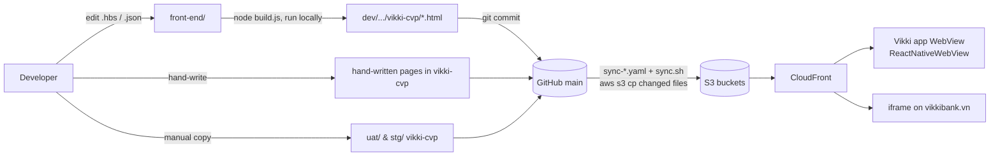

# 01 — Current State Audit: Vikki CVP pages

> Scope: the CVP landing pages served from `dev/s3-bucket-apse5-dev-vikki/vikki-cvp/` and the Handlebars generator in `dev/s3-bucket-apse5-dev-vikki/front-end/` that produces most of them. Includes how pages reach STG/UAT.
>
> Conventions used in all documents:
> - `FE/` = `dev/s3-bucket-apse5-dev-vikki/front-end/`
> - `OUT/` = `dev/s3-bucket-apse5-dev-vikki/vikki-cvp/`
> - **[FACT]** = verified in code or by running something. **[REC]** = recommendation. **[ASSUMPTION]** / **[UNKNOWN]** = not verified.
>
> Audit date: 2026-10-31, at commit `07f4ab8`.

---

## 1. System overview

**[FACT]** This is not an application. It is a static-content repository:

```
repo/
├── dev/s3-bucket-apse5-dev-vikki/       → s3://s3-bucket-apse5-dev-vikki  (CloudFront EYWEB0ASOTXLO)
│   ├── front-end/                       ← Handlebars generator (source). Only exists in dev.
│   └── vikki-cvp/                       ← committed build output + assets + hand-written pages
├── stg/s3-bucket-apse5-stg-vikki/vikki-cvp/        ← hand-copied subset (11 folders)
├── uat/non-prod-uat-vikki-587199685549/vikki-cvp/  ← hand-copied, nearly complete
├── sync.sh                              ← uploads changed files + CloudFront invalidation
└── .github/workflows/sync-{dev,stg,uat}.yaml
```



**[FACT] Runtime consumers**
- **Vikki mobile app WebView.**
  - `window.ReactNativeWebView.postMessage` is called in `FE/pages/vikki-one-connect/index.hbs:279-294` (`{action:'OPEN_CARD'}`).
  - It is also called in `OUT/td-cvp/td-cvp-mua-2.html:313` (`{redirectTo:'LuckySpinScreen', additionalData:{campaignCode}}`).
  - The app passes query params `hasTopSpace`, `hasCard`, `productScheme` and `category` (`FE/components/scripts.hbs:147-153`, `FE/pages/vikki-one-connect/index.hbs:233-262`, `FE/pages/promotion/list.hbs:29-46`).
- **Iframe embedding on a parent website.**
  - `booking-vja`, `golden-saving-landing-page` and `td-interest-cvp` post `{type:'setHeight'}` / `{type:'redirect'}` to the parent.
  - Each ships an `iframe.html` host page.
- **No backend, no API calls, no analytics.**
  - **[FACT]** No `fetch`, XHR, gtag, dataLayer or firebase appears in templates or hand-written pages.
  - **[FACT]** All content is resolved at **build time**.

---

## 2. The generator: `FE/build.js` (346 lines)

**[FACT]** Verified by copying `FE/` to a scratch dir and running `node build.js`:
- It produced **107 HTML files**.
- **All 107 are byte-identical** to the committed files in `OUT/`. The build is deterministic and the committed output is currently in sync with source.

### 2.1 Execution flow (traced)

```mermaid
flowchart TD
  A[buildAll: for each dir in pages/] --> B{data/&lt;page&gt;/en.json or vi.json exists?}
  B -- yes: LOCALE MODE --> L1[template = pages/&lt;page&gt;/&lt;page or data.filename&gt;.hbs]
  L1 --> L2[render → OUT/&lt;page&gt;/&lt;locale&gt;/&lt;filename&gt;.html]
  L2 --> L3[for each data.details[]: render &lt;detail.template or detail&gt;.hbs → &lt;locale&gt;/&lt;id&gt;.html]
  L3 --> L4[for each other top-level .hbs: if data/&lt;page&gt;/&lt;tpl&gt;-&lt;locale&gt;.json exists → render]
  B -- no: NORMAL MODE --> N1[for each top-level .hbs except detail.hbs]
  N1 --> N2[data = first of: &lt;tpl&gt;.json, list.json, &lt;page&gt;.json, index.json]
  N2 --> N3[body = compile(tpl)(data); html = layouts/&lt;data.layout or base&gt;.hbs]
  N3 --> N4[write OUT/&lt;page&gt;/&lt;tpl&gt;.html]
  N1 --> D1{detail.hbs && data.items[]?}
  D1 -- yes --> D2[for each item → OUT/&lt;page&gt;/&lt;item.id&gt;.html]
```

Key facts, with `build.js` line numbers:

| Concern | Behaviour | Evidence |
|---|---|---|
| Partials | Every `.hbs` under `components/` **and `layouts/`** is registered as a partial, namespaced by folder (`static/section`, `legal/blocks/list`) | `build.js:17-46` |
| Helpers | `eq`, `json` (escapes `<`), `inc`, `assetPath` (uses `data.assetBase`, default `./assets/`) | `build.js:8-10, 48-61` |
| Template discovery | Reads only the **top level** of `pages/<page>/`; subfolders are ignored | `build.js:131` |
| Data resolution | Implicit, by filename convention (4 candidates) | `build.js:76-92` |
| Layout selection | `data.layout` string, default `base` | `build.js:111-113, 297-299` |
| Page/Layout composition | page template rendered first → injected as `{{{body}}}` into layout | `build.js:108-123` |
| Locale | Opt-in per page when `en.json`/`vi.json` exists; hard-coded `['en','vi']` | `build.js:135-264` |
| Collections | `items[]` + `detail.hbs` (normal mode), `details[]` (locale mode): two different mechanisms | `build.js:180-221, 318-345` |
| Pre-processing | Only `qaGroup[].children[].numOrder` | `build.js:64-74` |
| Validation | Only detail ids/template names in locale mode (kebab-case, unique) | `build.js:185-213` |
| Output cleanup | **None.** Stale output is never deleted | whole file |
| Dev server | `--watch` rebuilds everything on any change, static server on :3000 | `build.js:357-418` |
| Dependencies | `handlebars ^4.7.8` only | `FE/package.json` |

### 2.2 Layouts (`FE/layouts/`)

| Layout | Role | Used by (via `data.layout`) |
|---|---|---|
| `base.hbs` | `header` → `{{{body}}}` → `footer` (popup, FAQ popup from `qaItems`, scripts) | vikki-go-cvp, vikki-pro-cvp (no `layout` key) |
| `template.hbs` | **Block renderer.** `{{{body}}}` then loops `components[]` and dispatches on `type` through an `{{#if (eq type …)}}` chain; FAQ popup from `qaGroup` | 13 CVP landing pages |
| `static.hbs` | Legal/T&C document: `header`, recursive `sections[]` → `articles[]` → `blocks[]`, `note`, `footer`; `{{{body}}}` appended at the end | ~20 tc/claim/insurance-wording pages |
| `legal-document.hbs` | Second legal-document renderer: `sections[].blocks[]`. **`{{{body}}}` is inside `<head>` (line 169)**, so page templates can only contribute CSS | home-loan, consumer-secured-loan tc |
| `fee.hbs` | Fee schedule: flat `blocks[]` + JS-built TOC; heading text hard-coded | 6 fee pages |
| `promotion.hbs` | Only CSS + `{{{body}}}` | promotion, card-intro |
| `blank.hbs` | Minimal shell + back-to-top | vikki-one-connect/intro |
| `safe-plus-detail.hbs` | Minimal shell | safe-plus plan details |

### 2.3 Components (`FE/components/`)

| Partial | Kind | Notes |
|---|---|---|
| `header`, `footer`, `styles` (714 lines CSS), `scripts` (310 lines JS) | Page chrome / runtime | All CSS/JS is inlined into every page |
| `video` | Hero video block | `src`/`poster` hard-coded to `./assets/video.mp4` / `poster.jpg`; HLS source comes from the page-level `bannerVideoHlsSrc` (`scripts.hbs:156`) |
| `topMenu`, `image`, `slider`, `qa`, `activation`, `tooltip`, `partners`, `title`, `cardInfo` | Content blocks | Rendered by the `template.hbs` dispatch chain; `cardInfo` is unused |
| `qaTemplate`, `popup`, `backLink` | UI helpers | |
| `safePlusOverview` (119), `safePlusPlanDetails` (192) | Product-specific widgets | Only vikki-safe-plus-cvp |
| `static/*`, `legal/*` | Document blocks: `section`, `article`, `toc`, `blocks/{paragraph,subheading,list,table}` | **Two parallel sets for the same block types** (near-identical one-line partials). Verified: all paragraph/subheading text in 30 data files reaches the output |

### 2.4 Shared runtime JS (`FE/components/scripts.hbs`)
- Accordion (2-45).
- Popup system (48-136): `data-popup="qa"` clones the FAQ `<template>`; a URL loads in an iframe, and PDFs get a retry loop.
- HLS hero video via `cdn.jsdelivr.net/npm/hls.js@1`, an **unpinned major version** (139-204).
- Swiper 11 element (206-226), smooth-scroll for `data-scroll` (229-264), back-to-top.
- Promo detail popup opened by `postMessage({type:'OPEN_PROMO_DETAIL'})` (286-311).
- **Defect [FACT, needs browser confirmation]:** `function closePopup` is declared at line 130 **and** at line 306.
  - The second declaration replaces the global.
  - The close button is bound at line 66, before the later script runs, so it keeps the first function.
  - The overlay-click handler (line 70) calls the global at click time, so clicking the backdrop of the main popup runs the **promo** close function.

---

## 3. Inventory of what is produced

### 3.1 Generated pages (18 source page folders → 107 HTML)
| Page | Layout(s) | Locale | Notes |
|---|---|---|---|
| card-co-badged-cvp | template / fee / static | – | Main template hard-codes menu, ~15 images, CTA links; 229 lines CSS |
| card-intro | promotion (items → detail) | – | `list.hbs` empty → `list.html` effectively empty |
| consumer-secured-loan-cvp, home-loan-cvp | template / legal-document | – | `index.hbs` **100% CSS**, identical apart from class prefix |
| promotion | promotion (items → detail) | – | 43 items in `list.json` |
| vikki-foreign-exchange-cvp | template / static | en, vi | `pages/.../en/`, `vi/` and `data/.../en/`, `vi/` are **dead** (never read) |
| vikki-go-cvp, vikki-pro-cvp | base / fee / static | – | Hand-coded page body; built `fee.html`/`tc.html` for go **are not linked** (page links to vikkibank.vn and a Google Docs viewer instead) |
| vikki-go-plus-cvp | template / fee / static | – | Hard-coded body + duplicated top menu (hbs + JSON) |
| vikki-golden-savings, vikki-savings-kilo-gold | template / static | – | 588-line `index.hbs` = 312 CSS + 276 JS, no markup; JS injects hotspots keyed on image filename (`img[src$="p-2.png"]`) |
| vikki-lixi-2026, vikki-loan-cvp, vikki-nnn-cvp, vikki-od-at-branch-cvp, vikki-od-cbnv-cvp | template / fee / static | (nnn: `language:"en"`) | `index.hbs` 100% CSS; nnn ≡ od-at-branch byte-for-byte |
| vikki-one-connect | template / blank / fee / static | – | App bridge (`OPEN_CARD`), `intro.hbs` with hard-coded copy |
| vikki-safe-plus-cvp | template / safe-plus-detail / static | en, vi | Most structured page: all copy in JSON, `details[]` → 3 plan pages |

### 3.2 Not generated (hand-written or orphaned) — 85 HTML files in `OUT/`
| Group | Files | Nature |
|---|---|---|
| GrapesJS-era campaign pages | `td-cvp.html`, `td-cvp/td-cvp.html`, `td-cvp/td-cvp-mua-2.html`, `loan-cvp/`, `credit-card-sale-cvp/`, `sim-cvp/` | Same CSS lineage (`gjs-row`/`gjs-cell`) that `styles.hbs` was copied from; image + video pages; Font Awesome |
| Image-only | `hd-saison-cvp/{en,vi}/`, `vneid-cvp/` | 75 lines, CSS only |
| Iframe widgets for a parent website | `booking-vja/`, `golden-saving-landing-page/`, `td-interest-cvp/` | Bespoke apps: jQuery+Slick+GSAP, a data-driven schedule/FAQ, an **interest calculator** with rate tables in JS (`td-interest-cvp/index.html:673-1047`) |
| Orphaned generator output | 70 × `promotion/promo-0XX.html`, `promotion/detail.html`, `vikki-foreign-exchange-cvp/index.html` | Items removed from `list.json` / page switched to locale mode; `build.js` never deletes, `sync.sh` never deletes from S3 |
| Empty | `vikki-lixi-2026_temp/` | |

### 3.3 Content characteristics
**[FACT]**
- **Marketing copy is mostly baked into images.** The 55 `imageSection` blocks, slider slides and section titles are PNG/JPG (`title.src`, `srcTitle`).
- **Text content is FAQ (Q&A) and legal documents.**
  - FAQ: one-connect alone has 200 Q&As in `qaGroup`.
  - Legal: `vikki-safe-plus-cvp/insurance-wording-vi.json` is 2,827 lines with 517 paragraphs.
- **Data volume:** `FE/data` totals about 41k lines of JSON. Legal/fee documents are about 85% of it.

---

## 4. Mechanism-by-mechanism audit

| Mechanism | Current implementation [FACT] | Limitations | Reuse? |
|---|---|---|---|
| **Content management** | JSON files in `FE/data/<page>/`, edited by developers in an IDE | No schema, no validation; copy-paste ids (`vikki-go-tnc` reused in lixi/loan), wrong titles (`od-cbnv` says "At Branch") | **Extend**: keep JSON-in-git, add schemas |
| **Content types / schemas** | Implicit: "CVP landing" (`components[]`+`qaGroup`), "legal doc" (`sections/articles/blocks`), "fee doc" (`blocks`), "collection" (`items[]`/`details[]`) | Not declared anywhere; 4 shapes of block nesting | **Formalise** |
| **Templates** | `pages/<page>/*.hbs` per page | 8 of 18 are CSS-only (style overrides), others hard-code content; heavy duplication | **Replace** per-page templates with typed page templates + themes |
| **Layouts** | 8 layouts selected by string | 3 renderers for legal docs (`static`, `legal-document`, `fee`); `base` vs `template` overlap | **Merge** |
| **Blocks / components** | `template.hbs` `if (eq type …)` chain, 10 types | Unknown `type` silently renders nothing; props undocumented; `video` ignores its own props | **Refactor into a registry** — this is the CMS seed |
| **Reusable sections** | Partials (`qa`, `slider`, `activation`) | Wrapper markup lives in the layout (slider/qa wrappers in `template.hbs:36-71`), not in the block | Refactor |
| **Static vs dynamic content** | All static, build-time; "dynamic" = query-param driven client JS | Runtime contract (params, bridge messages) undocumented | Document as a contract |
| **Configuration-driven rendering** | `components[]` order, `className`, `hasTopSpace`, `hasBackground`, `layout`, `assetBase`, `bannerVideoHlsSrc` | Page-level flags mixed with block config | Extend |
| **Data sources / APIs** | None at runtime. Cross-page references by URL only (`/vikki-cvp/promotion/list.html?category=VIKKI_ONE`) | Promotions/card-intro are collections but nothing validates the references | Build-time collections |
| **Localization** | Opt-in en/vi per page (`en.json`/`vi.json`, `<tpl>-<locale>.json`); UI strings hard-coded inline (`{{#if (eq language "en")}} FAQs {{else}} Hỏi đáp`, `template.hbs:89`) | Only 3 pages localised; `insurance-wording-en.json` body is Vietnamese with `language:"vi"` | Extend |
| **Media / assets** | Per-page `OUT/<page>/assets/`, cache-busting by renamed files (`playlist-20261012-223920.m3u8`, `two-golden-20261029-v01.png`); `FE/scripts/generate-hls.sh` | No shared asset library; 743 MB under `OUT/` (vikki-pro-cvp 134M); assets not referenced by any page are not detected | Keep + add manifest/lint |
| **Versioning / publishing** | Git commits; `version` field in some tc JSON (not used by code) | Publishing = commit output + manual copy to stg/uat; envs have drifted (§5) | Git stays the version store |
| **Preview / draft** | `npm run dev` local server on :3000; dev env effectively acts as preview | No WebView simulation; no per-PR preview | Extend |
| **Permissions** | CODEOWNERS: HRE admins + backoffice-maintainer on everything; backend-maintainer on `/sit/` and `/uat/` | No content vs code separation | Extend with path-based owners |
| **Runtime content resolution** | None. Client JS only toggles classes, opens popups, filters promos by `?category=` | – | Keep (no runtime CMS needed) |
| **Business authoring** | `FE/data/promotion/convertExcelToJson.html` + `promotionTemplate.xlsx`: business fills Excel → browser tool → dev pastes JSON | Tool has broken refs (`imageInput`), dead functions, non-padded ids, always `.png` | The only existing "admin" path — **evidence business wants to self-author promotions** |

---

## 5. Delivery and environments

**[FACT]**
- **What the workflows do.** `sync-{dev,stg,uat}.yaml` trigger on push to `main` under `<env>/**`. `sync.sh` then:
  - uploads each changed file with `aws s3 cp` (no `--delete`)
  - invalidates CloudFront.
- **Build sources are uploaded too.** `front-end/` is tracked inside the bucket folder, so changed sources (`.hbs`, `.json`, `promotionTemplate.xlsx`, `build.js`, `package-lock.json`) are uploaded to `s3://s3-bucket-apse5-dev-vikki/front-end/…`.
  - **[UNKNOWN]** Whether CloudFront serves that prefix publicly.
- **The build does not run in CI.** Committed HTML is the deployable.
- **STG and UAT are hand-copied and drift both ways.**
  - STG has 11 of 28 page folders.
  - **Neither environment is consistently newest.**
    - `td-cvp/td-cvp-mua-2.html`: UAT is newest (season 3, a richer bridge).
    - `vikki-go-cvp`: dev is newer.
    - `td-interest-cvp`: STG has December 2025 rates.
- **Env-specific values are hard-coded in pages.** `td-interest-cvp/iframe.html:18` in **dev** points to `vikki-cdn.sit.galaxyfinx.cloud`. `credit-card-sale-cvp` in dev links a **UAT** PDF.

---

## 6. Who changes what

**[FACT]** Since 2026-04-01, front-end commits came from 8 authors, all engineering accounts. Since 2026-06-01, changed files under `FE/` were:

| Path | File changes |
|---|---|
| `data/` | 111 |
| `pages/` | 79 |
| `components/` | 20 |
| `layouts/` | 6 |
| `build.js` | 3 |

Commit cadence peaked at 106/month (2026-02) and runs at about 15–45/month since.

**[ASSUMPTION]**
- The high `pages/` churn means routine content changes (new campaign, swapped banner) still require editing templates and CSS, not just data.
- The Excel→JSON tool suggests business teams originate content but cannot publish it themselves.
