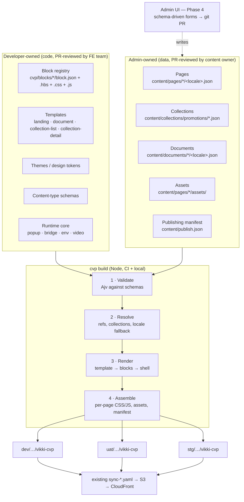
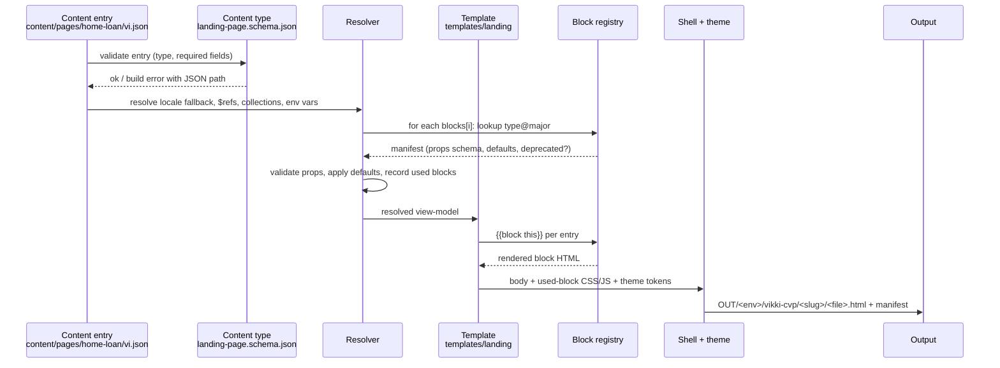

# 04 — Target Architecture

> **[REC]** throughout unless marked **[FACT]**. `FE/` = current `dev/s3-bucket-apse5-dev-vikki/front-end/`.

## 1. Guiding constraints (derived from the audit)

1. **Static output on S3/CloudFront, consumed by the app WebView and by iframes.** **[FACT]**
   - The CMS is a **build-time** system. Nothing in the target needs a runtime server.
2. **Git is the content store and the audit log.**
   - Every change is a commit, reviewed in a PR and deployed by the existing `sync-*.yaml`.
   - An admin UI, when added, writes to git rather than to a database.
3. **Developers own capabilities; admins own instances.**
   - Developers own: blocks, templates, themes and runtime actions.
   - Admins own: pages, collections, FAQs, legal docs, locales and env promotion.
   - Admins never write HTML, CSS or JS. (Rich text is limited to a sanitised subset; see 06 §5.)
4. **Evolve, don't rewrite.**
   - Handlebars, the JSON shapes and the output URLs stay.
   - Each existing page is migrated by proving the new build produces equivalent output.

## 2. Architecture style: Hybrid, block-centric, git-backed, build-time



Why this hybrid, in one paragraph. The variation between CVP pages is almost entirely in:
- block order (already data: `components[]`)
- images (already data)
- styling (today copy-pasted CSS; target: themes)

There are only four real page shapes, so a template-driven CMS would mostly add machinery nobody needs. A schema-driven CMS on its own would not tell anyone how a page renders. The blocks are where developer contracts meet admin choices, so the registry is the centre of the design. Comparison: 08 ADR-001.

## 3. Proposed folder structure

> **Superseded (2026-10-31):** the CVP system moves to a **separate repository**. The authoritative structure, build and publishing flow are in [09-standalone-repo-design.md](09-standalone-repo-design.md). The tree below is kept only to show the module breakdown; in the new repo `cvp/core` → `packages/engine`, `cvp/{blocks,templates,themes,content-types,runtime,shell}` → `packages/blocks`, and `content/` stays `content/`.

```
repo/
├── cvp/                                   ← NEW location (out of the synced bucket folder)
│   ├── package.json                       # handlebars, ajv (+ ajv-formats); nothing else in Phase 1
│   ├── cvp.config.json                    # envs, output dirs, CDN hosts, locales
│   ├── core/
│   │   ├── build.js                       # orchestrates validate → resolve → render → assemble
│   │   ├── registry.js                    # discovers blocks/templates/themes/content types
│   │   ├── validate.js                    # Ajv + lint rules
│   │   ├── resolve.js                     # $ref, collections, locale fallback, env substitution
│   │   ├── render.js                      # Handlebars env, helpers, block dispatch
│   │   ├── assemble.js                    # CSS/JS bundling per page, manifest, orphan detection
│   │   └── helpers/                       # eq, json, assetPath, t (i18n), action
│   ├── runtime/                           # browser JS shipped to pages (no framework)
│   │   ├── core.js                        # popup, scroll, back-to-top (from scripts.hbs)
│   │   ├── bridge.js                      # ReactNativeWebView + iframe postMessage contract
│   │   └── env.js                         # query-param contract: hasTopSpace, hasCard, productScheme, category
│   ├── shell/shell.hbs                    # ONE html shell (head, fonts, core css/js, popup, FAQ template)
│   ├── templates/
│   │   ├── landing/        {template.hbs, template.json}
│   │   ├── document/       {template.hbs, template.json}   # variants: tc | fee | legal
│   │   ├── collection-list/
│   │   └── collection-detail/
│   ├── blocks/
│   │   ├── hero-video/     {block.json, block.hbs, block.css, block.js, examples/}
│   │   ├── image/          …
│   │   ├── top-menu/  slider/  faq/  cta-links/  tooltip/  partner-grid/  title/
│   │   ├── doc-paragraph/  doc-subheading/  doc-list/  doc-table/
│   │   └── custom/         safe-plus-plans/  safe-plus-plan-detail/  golden-hotspots/ …
│   ├── themes/
│   │   ├── base.css                       # tokens: colors, radii, spacing, fonts (from styles.hbs)
│   │   ├── cvp-default.json  cvp-loan.json  cvp-card.json  cvp-savings-gold.json
│   ├── content-types/
│   │   ├── landing-page.schema.json  document.schema.json  promotion.schema.json  card-intro.schema.json
│   ├── tools/
│   │   ├── import-promotions.js           # replaces convertExcelToJson.html
│   │   ├── migrate/                       # one-off converters from FE/data → content/
│   │   └── generate-hls.sh                # moved from FE/scripts
│   └── test/                              # golden-output + schema tests
├── content/                               ← admin-owned data (CODEOWNERS: content team + FE)
│   ├── pages/<slug>/{vi.json, en.json, assets/}
│   ├── documents/<slug>/{vi.json, en.json}
│   ├── collections/promotions/<id>.json   # one file per item → clean diffs, no merge conflicts
│   ├── collections/card-intro/<id>.json
│   ├── faq/<set>.json                     # optional: shared FAQ sets
│   └── publish.json                       # which page versions go to which env
├── dev/ uat/ stg/                         ← unchanged: build output + bespoke pages
└── docs/architecture/content-template-management/
```

**Open question [UNKNOWN]:** should `cvp/` and `content/` live in this infra repo or in a separate front-end repo that publishes into it?
- This repo is owned by HRE (CODEOWNERS), with deploy workflows path-filtered on `dev/** uat/** stg/**`.
- Keeping them here is the smallest change: no new pipeline.
- A separate repo gives content owners their own permissions and CI.
- Decide in Phase 0. See 08 ADR-008.

## 4. Core modules

| Module | Responsibility | Built from (existing) |
|---|---|---|
| **Registry** | Scans `blocks/`, `templates/`, `themes/` and `content-types/`; loads `block.json` manifests; registers partials as `block/<name>@<major>`; exposes a typed catalogue (also exported as `registry.json` for the admin UI) | `build.js:17-46` (partial registration) |
| **Validator** | Content against content-type schema; each block against its `props` schema; lint rules: unique ids, assets exist, `$ref` targets exist, no hard-coded env hosts, no `<script>`/`style=` in rich text | `build.js:185-213` (the only validation today) |
| **Resolver** | Locale fallback (`en` → `vi` per field when allowed), collection queries, `$ref` to documents/pages, env substitution (`{{env.cdnHost}}`), FAQ featured selection | `build.js:76-101` (data candidates), `prepareNumOrder` |
| **Renderer** | Handlebars with `block` helper: `{{block this}}` dispatches through the registry and fails on unknown type. Templates own section wrappers; blocks own their markup | `layouts/template.hbs:11-77` |
| **Assembler** | Collects the CSS/JS of blocks used on the page plus the theme; inlines them (keeps today's single-file pages); writes HTML; writes `manifest.json` (page → files); reports orphans | `styles.hbs`, `scripts.hbs` |
| **Runtime core** | Small vanilla JS: popup, accordion, scroll, video, `bridge.dispatch(action)`, `env.get(param)` | `scripts.hbs` split |
| **Publisher** | Writes output per env from `publish.json`; CI check `git diff --exit-code` after build | replaces manual copying |

## 5. Rendering flow

The brief's generic flow, adjusted to what the code actually needs. There is no "layout resolution" step separate from the template. Data binding happens **before** rendering, so templates stay logic-free.



Fallback rules:
- **Unknown block type → build fails.** There is no silent drop as there is today.
- **Deprecated block version → build warning**, rendered through its `migrate()` to the current major if one is provided.
- **Missing optional asset → build fails** in CI and warns locally.
- **Missing locale →** per content type: documents require every declared locale; landing pages may fall back to `vi` per field if `localeFallback: true`.

## 6. API contracts

Because there is no runtime server, "API" means **file contracts**:

| Contract | Producer → Consumer | Format |
|---|---|---|
| `block.json` | Developer → Registry, Admin UI | See 06 §2 |
| `<type>.schema.json` | Developer → Validator, Admin UI | JSON Schema 2020-12 |
| `registry.json` (generated) | Build → Admin UI | `{blocks[], templates[], themes[], contentTypes[]}` |
| Content entry | Admin → Build | See 05 |
| `publish.json` | Admin → Publisher | `{ "home-loan-cvp": { "dev": "HEAD", "uat": "HEAD", "stg": false } }` |
| `manifest.json` (generated, per env) | Build → CI/sync | `{ files: [...], pages: {slug: [files]} }` |
| **Runtime contract** | Page ↔ App/Parent | See 06 §6: bridge actions, iframe messages, query params, versioned |

## 7. Versioning and compatibility

| What | How |
|---|---|
| Content | Git history: PR = revision, merge = publish to dev. Environment promotion = `publish.json` change |
| Blocks | `block.json.version` (semver). **Major** = breaking props change. Old majors kept until no content uses them (the registry reports usage). Optional `migrate.js` per major for automatic upgrades of content |
| Content types | `schemaVersion` field in each entry; migrations in `cvp/tools/migrate/` |
| Runtime contract | `bridge.js` sends `{v:1, …}`; additions are backward compatible; removals need app-team sign-off |
| Output URLs | **Frozen.** `/vikki-cvp/<slug>/<file>.html` stays identical. The app and vikkibank.vn deep-link to them |

## 8. What stays outside the CMS
- **Bespoke iframe widgets:** `booking-vja`, `golden-saving-landing-page`, `td-interest-cvp`. They are moved under the env build only for host substitution. **[REC]** Revisit `td-interest-cvp` once a `calculator` block plus a `rates` collection is justified.
- **Non-CVP folders in the bucket:** `campaign-management/`, `loan/`, `savings/`, and others. Out of scope.
