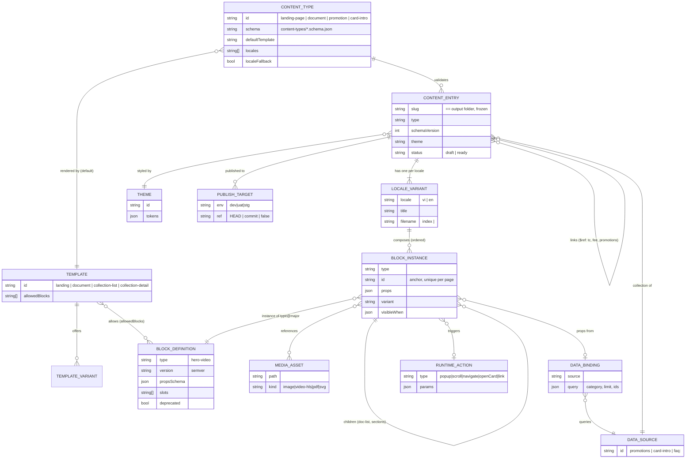

# 05 — Data Model and Relationships

> **[REC]** unless marked. Shapes are derived from the existing JSON in `dev/s3-bucket-apse5-dev-vikki/front-end/data/` so that migration is mostly mechanical.

## 1. Entity-relationship diagram



## 2. Entities

| Entity | Responsibility | Owner | Key attributes | Lifecycle | Managed via | Reusable? |
|---|---|---|---|---|---|---|
| **Content Type** | Declares the shape and rules of a kind of content | Developer | `id`, JSON Schema, `defaultTemplate`, `locales`, `localeFallback` | Changes via PR; `schemaVersion` bump + migration | Code | Yes |
| **Content Entry** | One page/document/promotion; its slug is the URL | Admin | `slug`, `type`, `schemaVersion`, `theme`, `status`, `links` | `draft` → `ready` → published per env | CMS (files) | No (instance) |
| **Locale Variant** | Per-locale data of an entry | Admin | `locale`, `title`, `blocks[]` / `sections[]` | Same as entry | CMS | No |
| **Template** | Turns an entry into a page body; owns section wrappers and page-level UI (FAQ popup, menus) | Developer | `id`, `allowedBlocks`, `variants` | Semver; rarely changes | Code | Yes |
| **Template Variant** | Named presentation option of a template (e.g. `document: tc \| fee \| legal`) | Developer | `id`, CSS class, defaults | With template | Code | Yes |
| **Block Definition** | Reusable unit: markup + props schema + CSS + JS | Developer | `type`, `version`, `propsSchema`, `variants`, `runtime`, `deprecated` | Semver, deprecate → remove when unused | Code | Yes |
| **Block Instance** | A configured use of a block in an entry | Admin | `type`, `id`, `props`, `variant`, `visibleWhen` | With entry | CMS | No |
| **Theme** | Design tokens + named styles replacing per-page CSS | Developer (tokens), Admin selects | `id`, tokens | Semver | Code | Yes |
| **Media Asset** | Image, video (HLS), PDF, icon | Admin uploads, Developer tools (HLS) | `path`, `kind` | Immutable filenames (`name-YYYYMMDD-vNN.ext`, already the practice) | Files | Per page; shared icons in `shell/assets` |
| **Data Source** | A build-time collection that blocks can query | Developer defines, Admin fills | `id`, item type | – | Code + CMS | Yes |
| **Data Binding** | Block prop filled from a data source | Admin | `{ "$source": "promotions", "where": {"category": "VIKKI_ONE"}, "limit": 6 }` | With instance | CMS | – |
| **Runtime Action** | Declarative interaction (replaces inline JS) | Developer defines types, Admin fills params | `type`, params | Versioned with runtime contract | Code + CMS | Yes |
| **Publish Target** | Which revision of an entry each env serves | Admin (with approval) | `env`, `ref` | Per release | CMS (`publish.json`) | – |

**Explicitly not entities:**
- **Layout.** Merged into Template + Shell.
- **Section.** A block wrapper owned by the template, except legal `sections`, which are content.
- **Template Version.** Git provides it.

## 3. Concrete shapes

### 3.1 Landing page entry (`content/pages/home-loan-cvp/vi.json`)
Mapped from today's `FE/data/home-loan-cvp/index.json`:

```json
{
  "$schema": "../../../cvp/content-types/landing-page.schema.json",
  "type": "landing-page",
  "schemaVersion": 1,
  "slug": "home-loan-cvp",
  "filename": "index",
  "title": "Vay mua nhà, đất | VikkiBank",
  "theme": "cvp-loan",
  "page": { "topSpace": true, "background": false },
  "links": {
    "terms": { "$ref": "document:home-loan-cvp-tc" }
  },
  "faq": {
    "groups": [ { "title": "…", "items": [ { "q": "…", "a": "<p>…</p>" } ] } ]
  },
  "blocks": [
    { "type": "top-menu", "props": { "items": [
      { "label": "Hỏi đáp", "icon": "./assets/qa.svg", "action": { "type": "popup", "target": "faq" } },
      { "label": "Giới thiệu", "icon": "./assets/info.svg", "action": { "type": "scroll", "target": "#intro" } }
    ] } },
    { "type": "hero-video", "props": { "hls": "./assets/video/playlist.m3u8", "mp4": "./assets/video.mp4", "poster": "./assets/poster.jpg" } },
    { "type": "image", "id": "intro", "props": { "src": "./assets/title-section.png" } },
    { "type": "faq", "props": { "titleImage": "./assets/qa.png", "featured": 5, "moreLabel": "Xem thêm" } },
    { "type": "cta-links", "variant": "full", "props": { "background": "white", "links": [ { "label": "Điều khoản & điều kiện", "popupTitle": "Điều khoản và Điều kiện", "action": { "type": "popup", "target": { "$ref": "links.terms" } } } ] } }
  ]
}
```

Changes from today:
- `components` → `blocks`.
- `video` gets its own props: the page-level `bannerVideoHlsSrc` moves into the block.
- `activation.termsButtonFullW` becomes the `cta-links` variant `full`.
- `qa` and `qaGroup` merge into `faq` plus `featured`.
- Raw `/vikki-cvp/...` URLs become `$ref`s.
- `className` becomes `theme`.

### 3.2 Document entry (`content/documents/home-loan-cvp-tc/vi.json`)
One recursive shape replaces the 4 current nestings:

```json
{
  "type": "document", "schemaVersion": 1, "slug": "home-loan-cvp", "filename": "tc",
  "variant": "legal",
  "header": { "logo": "assets/vikki-logo.png", "title": "…", "intro": ["…"] },
  "sections": [
    { "id": "s1", "title": "…", "expanded": true,
      "blocks": [ { "type": "doc-paragraph", "props": { "html": "…" } },
                  { "type": "doc-list", "props": { "style": "disc", "items": [ { "html": "…", "children": { "style": "dash", "items": [] } } ] } },
                  { "type": "doc-table", "props": { "headerRows": [], "rows": [] } } ],
      "sections": [] }
  ],
  "note": { "label": "Lưu ý", "html": "…" }
}
```

### 3.3 Collection item (`content/collections/promotions/promo-114.json`)
This is the same as a `list.json` item, one file per item:

```json
{ "type": "promotion", "id": "promo-114", "group": "HDB", "categories": ["VIKKI_ONE"],
  "code": "PRE114", "name": "…", "thumbnail": "./assets/promo-114.jpg",
  "shortDesc": "…", "longDesc": "<p>…</p>", "startDate": "2026-10-01", "endDate": "2026-12-31",
  "hotDeal": false, "extraData": "…" }
```

`promotionCate` becomes a `categories[]` array. Today it is a comma-separated string from Excel (`"VIKKI_ONE, VIKKIGO_PLUS, VIKKI_PRO"`).

### 3.4 Conditional visibility
This is only justified by existing query-param logic: `hasCard`, `productScheme`, `hasTopSpace`.

```json
{ "type": "cta-links", "visibleWhen": { "param": "hasCard", "notEquals": "true" }, "props": {} }
```

It is evaluated **client-side** by `runtime/env.js`, which toggles a `hidden` attribute. It is restricted to the declared runtime params, so it is not a general expression language.

## 4. Relationship rules (validated at build)
- `blocks[].type` must exist in the registry and in `template.allowedBlocks`.
- Every `$ref` must resolve: `document:<id>`, `page:<slug>`, `collection:<id>?…`.
- Block `id`s must be unique per page. Today `id:"intro"` is repeated on golden and kilo-gold.
- Asset paths must exist on disk.
- The output path `(slug, locale, filename)` must be unique across all entries. This prevents two entries overwriting one file.
- A collection item removed from content ⇒ its output file is listed as an orphan, and CI fails until it is deleted.
