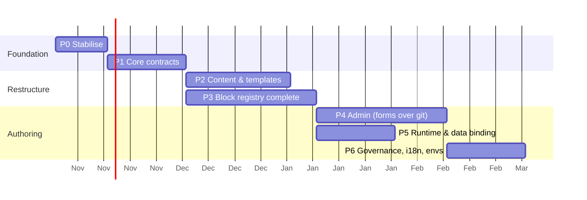

# 07 — Migration & Implementation Roadmap

> Incremental, strangler-style. The old `front-end/build.js` keeps working until the last page moves. Every phase ends with output that can be deployed through the existing `sync-*.yaml`.
>
> **Verification technique used throughout:** the build is deterministic today (107/107 files byte-identical on rebuild, **[FACT]**). Every migration step is accepted only if the new build produces the **same HTML** (or a reviewed, intentional diff) for the migrated pages.

*Durations are placeholders for planning [ASSUMPTION: 1–2 FE engineers]; the order and dependencies matter more than the dates.*

---

## Phase 0: Stabilise the existing architecture

**Scope** (no behaviour change for users):
1. CI job `cvp-check`: `cd FE && npm ci && node build.js && git diff --exit-code -- dev/s3-bucket-apse5-dev-vikki/vikki-cvp`. Fails if committed output ≠ build.
2. Delete orphaned output after confirming no live links:
   - 70 `promotion/promo-0XX.html`, `promotion/detail.html`, `vikki-foreign-exchange-cvp/index.html`, `vikki-lixi-2026_temp/`.
   - Grep the app and vikkibank.vn for links first: **[UNKNOWN]** external links. `promo-075` is still linked and is current.
   - Remember that `sync.sh` will not delete these from S3. Delete them there explicitly with an approved one-off `aws s3 rm` list.
3. Delete dead source: `FE/pages/vikki-foreign-exchange-cvp/{en,vi}/`, `FE/data/vikki-foreign-exchange-cvp/{en,vi}/`, `components/cardInfo.hbs`.
4. Fix verified defects:
   - Duplicate `closePopup` (`scripts.hbs:130/306`).
   - one-connect `productScheme` null crash and the `'vikkibank'`/`'vikki'` mismatch.
   - golden-savings filename-based hotspot (port the kilo-gold fix).
   - Pin `hls.js` and `swiper` versions.
5. Check whether `s3://…/front-end/*` is publicly reachable through CloudFront (P7). If it is, block it at CloudFront now.
6. Write down the runtime contract (06 §6) and confirm it with the mobile team.
7. ~~Decide ADR-008~~ **Decided: separate repository.** Phase 0 therefore also includes the repo split, steps 1–7 of [09 §6](09-standalone-repo-design.md#6-moving-to-the-new-repo-cut-over-plan):
   - Create `<cvp-repo>` with history.
   - Port the engine 1:1 with the legacy adapter, and pass the byte-identical parity gate.
   - Set up the bot publish PR.
   - Reconcile env drift.
   - Remove `front-end/` from the static repo.

   Items 1–4 above are then done **in the new repo**. The CI check becomes the publish diff, and orphans are deleted through the manifest. All later phases run in `<cvp-repo>`; paths written as `cvp/…` in this document map to `packages/engine` / `packages/blocks` (see 09 §2).

| Reuse | New | Depends on | Risks | Outcome |
|---|---|---|---|---|
| everything | 1 CI job | – | Removing a still-linked promo page | Drift between source and output becomes impossible; known bugs fixed |

**Acceptance criteria:**
- The CI check is green on `main`.
- `git ls-files OUT | grep promo-0` lists only ids present in `list.json`.
- The bug fixes are verified in a WebView (iOS + Android).

---

## Phase 1: Core abstractions and contracts

**Scope:**
- Create `cvp/` with `core/` (registry, validate, render, assemble) **wrapping the existing Handlebars partials**.
- Register the existing `components/*.hbs` as blocks by adding a `block.json` next to each one. Templates are still the current layouts.
- Add `content-types/*.schema.json` written to accept **today's data as-is**: `components[]`, `qaGroup`, the 4 document nestings.
- Validate all existing `FE/data` in CI, as a warning first and then as an error.
- Replace the `if (eq type)` chain in `template.hbs` with `{{block this}}` from the registry. Unknown type ⇒ error.
- Add the `env` config (`cvp.config.json`) with dev/uat/stg CDN hosts. No output for uat/stg yet.

| Reuse | New | Depends on | Risks | Outcome |
|---|---|---|---|---|
| All partials and layouts, `build.js` logic | registry, validator, schemas, `ajv` | P0 | Schemas too strict and block authors; mitigate with warn-mode first | Every page validated; blocks discoverable; same HTML |

**Acceptance criteria:**
- The new `cvp build` output is byte-identical to `FE/build.js` for all 107 files.
- Schema errors point to file plus JSON path.
- A block added as a folder renders without editing any core file.

---

## Phase 2: Content and template restructuring

**Scope:**
- **Document template.** Merge `static`, `legal-document` and `fee` into `templates/document` with variants. Convert the 32 live document JSON files to the single recursive shape with `tools/migrate/documents.js`.
- **Landing template.** Merge `base` + `template`. Move `video` props into the block. Merge `qa`/`qaGroup`/`qaItems` into `faq`. `activation` becomes `cta-links` (with `migrate`).
- **Themes.** Extract the CSS-only page templates into `themes/*.json` + `base.css`:
  - Start with the identical groups: home-loan ≡ consumer-secured; od-at-branch ≡ nnn ≈ od-cbnv ≈ lixi.
  - Remove the per-page `.hbs` files.
- **Collections.** Promotions and card-intro become one file per item. `details[]` (safe-plus) and `items[]` become one mechanism.
- **Content move.** Move content from `FE/data/` to `content/`.
- **Hard-coded pages.** Convert vikki-go, pro, go-plus and co-badged from hard-coded hbs to `blocks[]`. This also removes the duplicated top menu (P2).
- **Repoint the build.** `FE/build.js` is retired for migrated pages; the output paths stay the same.

| Reuse | New | Depends on | Risks | Outcome |
|---|---|---|---|---|
| Handlebars partials, CSS (moved to blocks/themes) | migrate scripts, themes | P1 | Visual regressions from CSS consolidation | A new CVP page = JSON + assets only |

**Acceptance criteria:**
- Every migrated page passes either a byte-identical diff or a screenshot diff below threshold at 375×812 and 414×896 (Playwright, [REC]). Intentional changes need sign-off.
- `pages/` contains no CSS-only templates.
- Zero raw `/vikki-cvp/...` URLs remain in content; `$ref` is used instead.

---

## Phase 3: Component / block registry, complete

**Scope:**
- Split `styles.hbs` and `scripts.hbs` into block-owned CSS/JS plus `runtime/core.js`. Pages include only what they use.
- Add `examples/` to every block, and a generated **block catalogue page** (`cvp catalogue` writes a static HTML page published to dev only).
- Add semver, deprecation and `migrate` support, plus a usage report.
- Turn the business widgets into custom blocks: `safe-plus-*`, `partner-grid` with the `openCard` action, `golden-hotspots` (data-driven positions instead of selector hacks).
- Add `registry.json` export.

| Reuse | New | Depends on | Risks | Outcome |
|---|---|---|---|---|
| Existing partials | catalogue, usage report | P1 (can run in parallel with P2) | Per-page CSS/JS ordering bugs | Smaller pages; self-documenting blocks |

**Acceptance criteria:**
- Removing a block that is still used fails CI.
- The catalogue renders every example.
- Average page size is no larger than today. Measure first; today every page inlines 714 lines of CSS and 310 lines of JS.

---

## Phase 4: CMS administration capabilities

**Scope:**
- Decide ADR-007: Decap CMS vs a thin in-house editor. Run a 1-week spike of Decap generated from `registry.json`.
- Admin flows:
  - create/edit pages, documents and promotions
  - reorder blocks
  - upload assets
  - preview at WebView size with query-param toggles
  - save as a PR
- Replace `convertExcelToJson.html` with `cvp import promotions.xlsx`, which validates and writes one file per item. This keeps the Excel flow business already uses.
- Set CODEOWNERS on `content/**` to content owners plus FE, and on `cvp/**` to FE only.

| Reuse | New | Depends on | Risks | Outcome |
|---|---|---|---|---|
| registry.json, schemas, renderer | admin app, OAuth proxy (Decap) | P2, P3 | Org approval for OAuth app [UNKNOWN]; editors needing training | Business can create a CVP/promotion without a developer, still reviewed |

**Acceptance criteria:**
- A non-developer creates a new promotion and a new landing page from existing blocks.
- The change goes through a PR and is live on dev after merge.
- There is no path to inject script (verified with a test entry containing `<script>`, `onerror=` and `javascript:`).

---

## Phase 5: Runtime rendering and data binding

**Scope:**
- `bridge.js` with the typed actions from 06 §6, versioned `{v:1}`, replacing the per-page inline bridge code. Confirm the `navigate` screen enum with the mobile team.
- `visibleWhen` on the declared params (`hasCard`, `productScheme`, `hasTopSpace`).
- Collection bindings: a `promo-strip` block with `{ "$source":"promotions", "where":{"category":"VIKKI_ONE"} }` replaces the hand-maintained promo links in sliders.
- Optional: a `rates` collection plus a `calculator` block to absorb `td-interest-cvp`. Do this only if business wants rate updates without developer help.

| Reuse | New | Depends on | Risks | Outcome |
|---|---|---|---|---|
| scripts.hbs logic, one-connect/td-cvp bridge code | bridge, env, binding resolver | P3 | App version skew (older app builds) | No inline JS in content; app interactions are declarative |

**Acceptance criteria:**
- `grep -r ReactNativeWebView content/ cvp/blocks` finds nothing outside `runtime/bridge.js`.
- A bridge contract test page exists on dev for QA with the app.

---

## Phase 6: Versioning, localization, publishing, governance

**Scope:**
- **Single build writes dev/uat/stg outputs** from `publish.json`. Stop hand-copying.
  - Migrate the bespoke iframe widgets' hosts to `{{env.cdnHost}}`. This fixes dev → sit and dev → uat links.
  - Align STG/UAT with an explicit, reviewed diff. **Neither is consistently newest today**, so each page must be decided individually with its owner.
- **Localization.** `t()` for UI strings that are hard-coded today (`Hỏi đáp`/`FAQs`, `Điều khoản và Điều kiện`, the fee heading). Add a per-type locale policy and a "missing translation" report. Fix `insurance-wording-en.json`, whose body is Vietnamese.
- **Governance.** Branch protection on `content/**`, an approval matrix (legal docs require a Legal reviewer [ASSUMPTION]), and a release note generated from merged content PRs.
- **Cleanup.** Optional CI `aws s3 rm` for files in the previous manifest but not the current one, scoped to `vikki-cvp/`. This requires an HRE decision because `sync.sh` deliberately never deletes.

| Reuse | New | Depends on | Risks | Outcome |
|---|---|---|---|---|
| sync workflows unchanged | publisher, manifest diff, i18n helper | P2, P4 | Accidentally promoting dev content to stg | Environments reproducible from git; drift is gone |

**Acceptance criteria:**
- `cvp build --all-envs && git diff --exit-code` passes.
- No hand edits under `uat/**/vikki-cvp` or `stg/**/vikki-cvp` except bespoke pages listed in an allow-list.

---

## Renderer migration (Handlebars → Preact JSX)
If the spike in [10 §5.3](10-template-engine-evaluation.md) is a go, the renderer swap runs alongside Phases 1–3 as M0–M5 in [10 §7](10-template-engine-evaluation.md#7-migration-plan-handlebars--preact-jsx-rec). The 4 new templates in Phase 2 are then written directly in JSX.

## What is deliberately *not* in the roadmap
- Replacing Handlebars with a JS framework (React/Next/Astro). See 08 ADR-002.
- A database-backed headless CMS. See 08 ADR-003.
- Migrating the bespoke iframe widgets into blocks before Phase 5.
