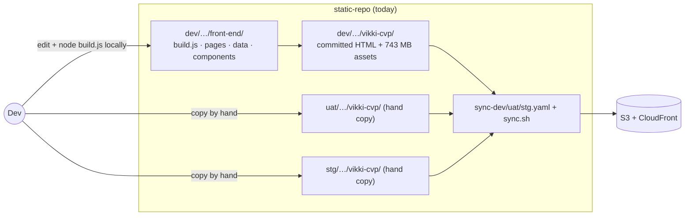
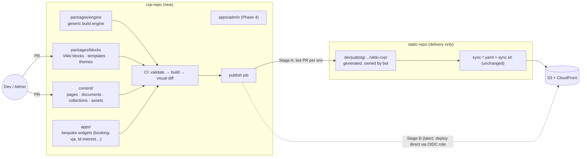
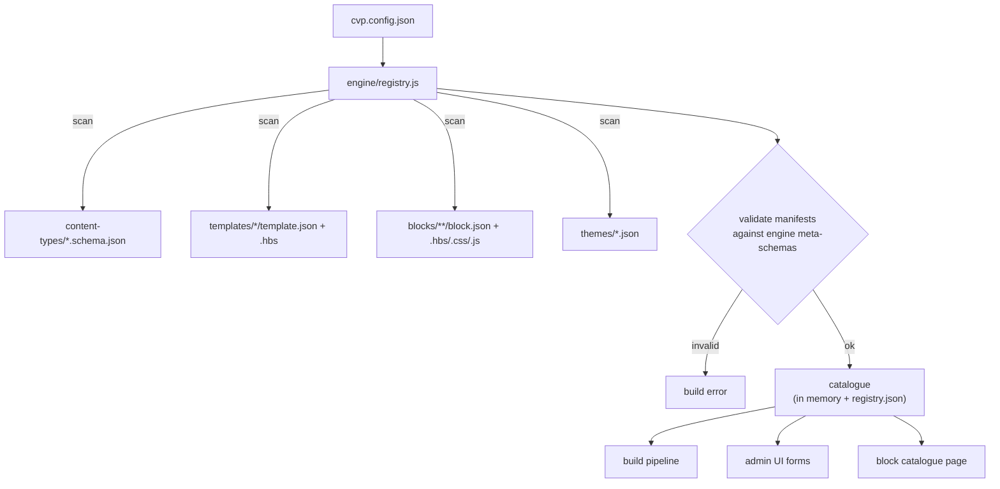
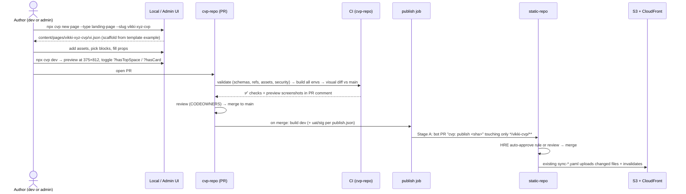
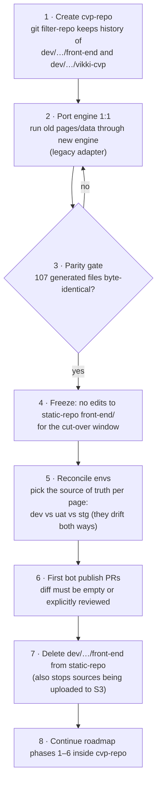

# 09 — Standalone CVP Repository: Structure, Build & Generic Management

> **Decision taken (2026-10-31):** the CVP generator and its content move out of `non-prod-workload-cloudfront-static-contents` into a **separate repository**. This supersedes the "same repo" option in ADR-008 and the folder layout in 04 §3.
>
> Placeholder names: `<cvp-repo>` = the new repository (e.g. `GalaxyFinX/vikki-cvp`); `<static-repo>` = `GalaxyFinX/non-prod-workload-cloudfront-static-contents`.
>
> **[FACT]** = verified in the current code. **[REC]** = recommendation. **[OPEN]** = needs a decision.

---

## 1. Before and after

**Today [FACT]:** source, output, hand-copies and deployment all live in one infra repo.



**Target [REC]:** the CVP repo owns the source and the build. The static repo becomes delivery only.



---

## 2. Repository structure

npm workspaces only. **[REC]** Do not add Nx or Turborepo at this size.

```
<cvp-repo>/
├── package.json                      # workspaces: packages/*, apps/*
├── cvp.config.json                   # PROJECT config (the only Vikki-specific wiring)
├── packages/
│   ├── engine/                       # GENERIC — knows nothing about Vikki/CVP
│   │   ├── src/
│   │   │   ├── cli.js                # cvp build | dev | new | validate | migrate | import | publish
│   │   │   ├── config.js             # loads cvp.config.json
│   │   │   ├── registry.js           # discovers content-types / templates / blocks / themes
│   │   │   ├── validate.js           # Ajv + lint rules
│   │   │   ├── resolve.js            # locale fallback, $ref, collections, env vars
│   │   │   ├── render.js             # Handlebars env, {{block}} helper
│   │   │   ├── assemble.js           # per-page CSS/JS, assets, manifest.json
│   │   │   ├── dev-server.js         # watch + preview (WebView frame, query-param toggles)
│   │   │   └── publish/
│   │   │       ├── to-static-repo.js # Stage A: write env folders + open PR
│   │   │       └── to-s3.js          # Stage B: aws s3 sync + invalidation
│   │   ├── schemas/                  # meta-schemas: block.json, template.json, content-type
│   │   └── test/
│   ├── blocks/                       # VIKKI capability package (developer-owned)
│   │   ├── shell/                    # html shell, fonts, base.css, runtime core
│   │   ├── runtime/                  # bridge.js (ReactNativeWebView/postMessage), env.js (query params)
│   │   ├── content-types/            # landing-page, document, promotion, card-intro (*.schema.json)
│   │   ├── templates/                # landing/ document/ collection-list/ collection-detail/
│   │   ├── blocks/                   # hero-video/ image/ top-menu/ slider/ faq/ cta-links/ tooltip/
│   │   │   │                         # partner-grid/ title/ doc-paragraph/ doc-list/ doc-table/ …
│   │   │   └── custom/               # safe-plus-*/ golden-hotspots/ …
│   │   └── themes/                   # cvp-default, cvp-loan, cvp-card, cvp-savings-gold
│   └── migrate-legacy/               # one-off: front-end/data → content/ converters (deleted after cut-over)
├── content/                          # ADMIN-owned data
│   ├── pages/<slug>/{vi.json,en.json,assets/}
│   ├── documents/<slug>/{vi.json,en.json}
│   ├── collections/promotions/<id>.json
│   ├── collections/card-intro/<id>.json
│   └── publish.json                  # which entries go to uat / stg
├── apps/
│   ├── bespoke/                      # hand-written pages copied through (with env-host substitution)
│   │   ├── booking-vja/  golden-saving-landing-page/  td-interest-cvp/
│   │   └── legacy/ td-cvp/ loan-cvp/ credit-card-sale-cvp/ sim-cvp/ hd-saison-cvp/ vneid-cvp/
│   └── admin/                        # Phase 4: schema-driven editor → PRs to this repo
├── .github/
│   ├── CODEOWNERS                    # packages/** → FE; content/** → content owners + FE
│   └── workflows/ ci.yml · publish.yml · visual.yml
└── docs/
```

### Why three layers
| Layer | Owns | Changes when | Knows about Vikki? |
|---|---|---|---|
| `packages/engine` | How to validate, resolve, render, assemble and publish **any** block-based static site | Rarely: new engine features | **No.** Everything comes from config and the registry |
| `packages/blocks` | **What** can be built: content types, templates, blocks, themes, runtime contract | A new capability is needed | Yes |
| `content/` | **Which** pages exist and what they say | Daily | Yes (data only) |

This is what "generic management" means here. The engine is driven entirely by what it discovers. Adding a new kind of page means adding a content type and a template folder to `packages/blocks`; the engine is untouched. A second brand or bucket could reuse `engine` with its own `blocks` package and `content`.

---

## 3. Generic management: how the engine discovers everything

### 3.1 Project config (`cvp.config.json`)
This is the only place where Vikki-specific paths and environments are wired.

```json
{
  "capabilities": ["packages/blocks"],
  "content": "content",
  "apps": { "bespoke": "apps/bespoke" },
  "locales": { "default": "vi", "supported": ["vi", "en"] },
  "output": { "basePath": "vikki-cvp" },
  "environments": {
    "dev": { "cdnHost": "https://<dev-cdn-host>", "target": { "repo": "<static-repo>", "dir": "dev/s3-bucket-apse5-dev-vikki/vikki-cvp" } },
    "uat": { "cdnHost": "https://vikki-cdn.uat.galaxyfinx.cloud", "target": { "repo": "<static-repo>", "dir": "uat/non-prod-uat-vikki-587199685549/vikki-cvp" } },
    "stg": { "cdnHost": "https://<stg-cdn-host>", "target": { "repo": "<static-repo>", "dir": "stg/s3-bucket-apse5-stg-vikki/vikki-cvp" } }
  },
  "security": { "allowedLinkHosts": ["vikkibank.vn", "*.galaxyfinx.cloud"] }
}
```

**[OPEN]** The dev and stg CDN hostnames. The code only shows `vikki-cdn.{prod,uat,sit}.galaxyfinx.cloud`.

### 3.2 Discovery: convention over registration



| Capability | Developer adds | Engine does automatically |
|---|---|---|
| New block | `blocks/<type>/block.json` + `block.hbs` (+ css/js/examples) | Registers the partial, validates props in content, bundles CSS/JS only on pages that use it, exposes it in `registry.json` and the admin UI |
| New template | `templates/<id>/template.json` (`allowedBlocks`, variants) + `template.hbs` | Makes it selectable by content types |
| New content type | `content-types/<id>.schema.json` with `x-cvp: { template, output, collection? }` | Validates entries, routes them to the template, computes output paths |
| New theme | `themes/<id>.json` (tokens) | Emits CSS variables; selectable per page |
| New runtime action | Add a handler in `runtime/bridge.js` + an enum entry in the `cvp:action` schema | Validated in content |

The content-type schema carries its own routing, so the engine needs no `if (type === 'promotion')` code:

```json
{
  "$id": "promotion",
  "x-cvp": {
    "template": "collection-detail",
    "collection": { "id": "promotions", "list": { "slug": "promotion", "filename": "list", "template": "collection-list" } },
    "output": "{basePath}/promotion/{id}.html"
  },
  "type": "object",
  "required": ["id", "name", "thumbnail", "startDate", "endDate"],
  "properties": { "id": { "pattern": "^promo-\\d{3}$" } }
}
```

---

## 4. How a new page is built

### 4.1 Developer/admin workflow



### 4.2 The build pipeline (one command: `cvp build --env dev`)

```mermaid
flowchart LR
  subgraph In[Inputs]
    C1[content/**]
    C2[packages/blocks/**]
    C3[apps/bespoke/**]
    C4[cvp.config.json → env]
  end
  In --> S1["1 · Load & discover<br/>registry + entries"]
  S1 --> S2["2 · Validate<br/>schema · unique ids · assets exist<br/>$ref resolve · URL allow-list · sanitize rich text"]
  S2 --> S3["3 · Resolve<br/>locale fallback · collections · $ref → URL<br/>{{env.cdnHost}} · FAQ featured"]
  S3 --> S4["4 · Render<br/>template → {{block}} per item → shell"]
  S4 --> S5["5 · Assemble<br/>inline used CSS/JS · copy changed assets<br/>bespoke apps w/ env substitution"]
  S5 --> S6["6 · Manifest<br/>dist/&lt;env&gt;/manifest.json<br/>file → sha256, owner=cvp"]
  S6 --> OUT["dist/&lt;env&gt;/vikki-cvp/**"]
```



The output URLs stay `/vikki-cvp/<slug>/<file>.html`, **unchanged**. The app and vikkibank.vn link to them.

### 4.3 Publishing to the static repo (Stage A, recommended first)
1. Check out `<static-repo>` and replace the target dir **only for files in the manifest**:
   - Add or update the changed files (by sha256).
   - Delete files that were in the **previous** manifest but not the new one. This is how orphans like today's 70 `promo-0XX.html` disappear.
2. Commit the manifest too: `<target dir>/.cvp-manifest.json`. The next publish diffs against it.
3. Open or update **one PR per env**, titled `cvp: publish <cvp-sha> to dev`.
4. Once merged, the existing `sync-*.yaml` deploys. **No change to `sync.sh`**, which uploads only changed files.
   - Deletions are still not propagated to S3 [FACT: `sync.sh` skips them], so the publish job prints the deleted keys for an approved `aws s3 rm`. Stage B removes this gap.

**Needs from HRE [OPEN]:**
- A GitHub App or bot token allowed to open PRs on `<static-repo>`.
- CODEOWNERS for `*/vikki-cvp/**` → the bot plus FE leads, so routine publishes don't wait on HRE.
- Agreement that hand edits under `*/vikki-cvp/**` stop. CI in `<static-repo>` can reject PRs that touch manifest-owned files without the bot.

### 4.4 Stage B: direct deploy (later, optional)
- `<cvp-repo>` assumes the same roles `sync.sh` uses (`vikki-mobile-dev-cloudfront-s3-rw-assume-role`, …) through **GitHub OIDC**.
- It then runs `aws s3 sync dist/<env>/vikki-cvp s3://<bucket>/vikki-cvp --delete` and invalidates CloudFront.
- `*/vikki-cvp/**` is then removed from `<static-repo>`.
- **Trade-off:** fully separated and deletions handled, but it needs IAM trust changes owned by HRE, and the infra repo loses its review gate on this prefix.

### 4.5 Environment promotion
`content/publish.json` controls what uat/stg receive. dev always gets `main`.

```json
{
  "uat": { "default": "main", "pin": { "td-cvp": "a1b2c3d" } },
  "stg": { "default": false, "include": ["vikki-go-plus-cvp", "card-co-badged-cvp", "booking-vja"] }
}
```

- `default: false` means only the listed entries are published. This reflects today's reality: STG has 11 of 28 folders.
- `pin` builds that entry from an older commit of `content/`, for a campaign frozen in UAT.

---

## 5. Who owns what after the split

| Path | Owner (CODEOWNERS) | Review rule |
|---|---|---|
| `<cvp-repo>/packages/engine/**` | FE platform | 1 FE approval + tests |
| `<cvp-repo>/packages/blocks/**` | FE | 1 FE approval + visual diff |
| `<cvp-repo>/content/pages/**`, `collections/**` | Content owners per domain + FE | 1 owner approval; CI must pass |
| `<cvp-repo>/content/documents/**` (T&C, fees) | Content owner + **Legal/Product reviewer [ASSUMPTION]** | 2 approvals |
| `<cvp-repo>/content/publish.json` | FE leads | Promotion to stg needs 1 lead |
| `<static-repo>/*/vikki-cvp/**` | cvp-publish bot (+ FE leads) | Auto-merge after checks [OPEN with HRE] |
| `<static-repo>` everything else | Unchanged (HRE, backoffice, backend) | Unchanged |

---

## 6. Moving to the new repo (cut-over plan)



| Step | Notes |
|---|---|
| 1 | `git filter-repo --path dev/s3-bucket-apse5-dev-vikki/front-end --path dev/s3-bucket-apse5-dev-vikki/vikki-cvp`, then move into the new layout. Keeps blame and history. Follow with `git lfs migrate import --include="*.mp4,*.ts,*.png,*.jpg,*.jpeg"` so history blobs also go to LFS |
| 1 (assets) | 743 MB of assets, including `.mp4`/`.ts` video segments. **[REC]** Put `*.mp4 *.ts *.m3u8 *.png *.jpg` under **Git LFS** in `<cvp-repo>`. The static repo keeps plain files because the sync workflow needs them on disk |
| 2 | The legacy adapter lets the new engine render `front-end/pages/*.hbs` + `data/*.json` unchanged. Migration to blocks/themes (roadmap Phase 2) happens **after** the move, page by page |
| 3 | Same byte-identical technique already verified on the current build [FACT] |
| 5 | Known drift: `td-cvp-mua-2.html` is newest in UAT; `vikki-go-cvp` is newest in dev; `td-interest-cvp` STG has December 2025 rates. Each needs an owner decision |
| 7 | Closes finding P7 (sources in the bucket) |

**Risks**
| Risk | Mitigation |
|---|---|
| Duplicate asset storage in two repos (Stage A) | LFS in `<cvp-repo>`; Stage B removes the copy |
| Hot-fix needed while the publish bot or the PR is blocked | Documented break-glass: an FE lead may edit the static repo directly, and the next publish then overwrites it, so the fix must be back-ported to `<cvp-repo>` the same day |
| Someone edits the generated output by hand | `<static-repo>` CI check: files listed in `.cvp-manifest.json` may only change in bot PRs |
| Old app versions deep-link removed orphan URLs | Before deleting, check CloudFront logs for hits on the orphan list [OPEN: are logs enabled?] |

---

## 7. Open decisions for this design
1. Repo name and org location of `<cvp-repo>`.
2. Stage A (bot PR) only, or plan Stage B (OIDC direct deploy) now. Needs HRE.
3. Bot identity: a GitHub App vs a fine-grained PAT. An App is recommended because it is auditable and not tied to a person.
4. Git LFS approval and quota.
5. CDN hostnames for dev/stg, for `cvp.config.json`.
