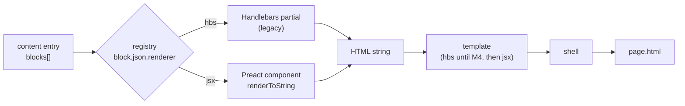

# 10 — Template Engine Evaluation: Is there a better fit than Handlebars?

> Research date: 2026-10-31. **[FACT]** = verified in code or a cited source. **[REC]** = recommendation. **[ASSUMPTION]** / **[UNKNOWN]** = needs confirmation.
>
> This revisits ADR-002 ("Keep Handlebars, re-evaluate Eleventy at the end of Phase 3") in light of the decision to move CVP into its own repo (09). A new repo with a new engine is the cheapest point to change the renderer.

---

## 1. How Handlebars is used today [FACT]

| Measure | Value |
|---|---|
| Dependency | `handlebars ^4.7.8`, the only dependency (`front-end/package.json`) |
| `.hbs` files | 93 files, ~9,960 lines (a large share is CSS embedded in page templates) |
| Constructs used | `{{#if}}` ×119, `{{#each}}` ×37, partials, `{{{triple-stash}}}` for raw HTML |
| Custom helpers | 4: `eq`, `json`, `inc`, `assetPath` (`build.js:7-56`) |
| Not used | inline partials, decorators, `{{#with}}`, partial blocks, precompilation |

**Consequence:** the existing templates use a small, portable subset. Porting them to another engine is mechanical, and the byte-identical parity gate (09 §6 step 3) can stay on the legacy Handlebars renderer while new blocks use something else.

## 2. What the target architecture needs from a renderer

From 04, 06 and 09:

| # | Requirement | Why |
|---|---|---|
| R1 | **Block = component** with declared props and its own CSS/JS | The block registry is the centre of the design (ADR-001) |
| R2 | **Typed / validated props**, exportable to JSON Schema | Ajv validation in CI and generated admin forms (`registry.json`) |
| R3 | **Static HTML, no client framework** | Output runs in the RN WebView and iframes; no interactive need (ADR-002) |
| R4 | **Escape by default**; raw HTML only through one sanitised path | Admin-entered rich text (06 §5) |
| R5 | **Dynamic dispatch by type string** | Content says `{ "type": "faq" }`; the engine must stay generic (09 §3) |
| R6 | **Renders in the browser too** | The admin UI preview (Phase 4) should use the same renderer, not a re-implementation |
| R7 | **Coexists with Handlebars** during migration | Legacy pages pass the parity gate unchanged; migrate block by block |
| R8 | **Deterministic output** | Manifest diffing (sha256) and visual diffs depend on it |
| R9 | **Maintained**, small dependency footprint | Bank context, long-lived content |
| R10 | **Team familiarity** | The product is a React Native app, so the org already works in JSX/TypeScript **[ASSUMPTION: confirm the FE team's stack]** |

## 3. Candidates

### 3.1 String template languages

| Engine | Strengths | Weaknesses for this project | Verdict |
|---|---|---|---|
| **Handlebars 4.x** (current) | Logic-less; tiny; runs in browser; team already uses it | No component model: partials have no prop contract, CSS/JS not co-located (R1, R2 ✗). Errors surface at render time. No release found after 4.7.8 **[UNKNOWN: check npm for activity]** | Keep **only as legacy renderer** |
| **Nunjucks 3.x** | Macros, inheritance, filters (Jinja-like) | Still at 3.2.4, no newer release found ([Debian tracker](https://tracker.debian.org/node-nunjucks)). Macros give no typed props | ✗ maintenance risk |
| **LiquidJS 10.x** | Actively maintained (10.26/10.27 in May 2026); designed for **untrusted** templates | Its main advantage, sandboxing templates written by non-developers, is not needed: in our design admins edit **data**, not templates. No component/props model. A 2026 advisory on `ownPropertyOnly` ([CVE-2026-106120](https://vulert.com/vuln-db/CVE-2026-106120)) shows the sandbox itself is attack surface | ✗ solves a problem we don't have |
| **EJS / Eta** | Fast, plain JS | Arbitrary JS in templates, no escaping discipline, no components | ✗ |

### 3.2 Component renderers (render to static HTML)

| Engine | Strengths | Weaknesses | Verdict |
|---|---|---|---|
| **Preact + JSX/TSX → `preact-render-to-string`** (6.x, [npm](https://npmjs.com/package/preact-render-to-string)) | A block is a function with typed props (R1, R2). Escapes by default; raw HTML only via `dangerouslySetInnerHTML`, which can be confined to one `<RichText>` component and lint-banned elsewhere (R4). Dispatch is a map lookup (R5). Same components render in the browser for admin preview (R6). No client JS shipped (R3). Familiar to a React/RN org (R10) | Needs a compile step for JSX/TS (esbuild, one dev dependency). CSS is not scoped automatically: keep `block.css` next to the component and let the assembler bundle it (already planned in 04 §4) | **Recommended** |
| **Svelte 5 server render** | Compiled, scoped CSS per component | Compiler and its own syntax; browser preview needs the compiled client build; less familiar to a React org | Viable, second choice |
| **Lit SSR** | Web standards | SSR output is designed for hydration (declarative shadow DOM); overhead for pure static pages | ✗ |

### 3.3 Site frameworks (replace the engine, not just the renderer)

| Framework | Strengths | Weaknesses | Verdict |
|---|---|---|---|
| **Astro** | Best component model for static sites: scoped CSS, zero JS by default, content collections validated with Zod on every build ([docs](https://docs.astro.build/core-concepts/collections)) | It **is** the engine: routing, collections and build pipeline overlap with `packages/engine`, `x-cvp` routing and the registry. Rendering components outside its build (admin preview) uses the Container API, which is still **experimental** ([docs](https://docs.astro.build/en/reference/container-reference)). Output post-processing (hashed assets, HTML formatting) makes the byte-identical parity gate harder; legacy pages would need to be wrapped | Strong alternative **if** the team prefers adopting a framework over owning an engine |
| **Eleventy 3 + WebC** | Can keep Handlebars via the official plugin ([docs](https://11ty.dev/docs/languages/handlebars)); WebC bundles per-component CSS/JS ([plugin](https://github.com/11ty/eleventy-plugin-webc)) | Handlebars was moved out of core in v3 ([release notes](https://github.com/11ty/buildawesome/releases/tag/v3.0.0-beta.1)), a sign of where it is heading. WebC is 0.x and niche. Like Astro, Eleventy owns the pipeline and duplicates the engine | ✗ for the new repo; was the cheap upgrade path only while staying in the old repo |

## 4. Scoring

Scores: ● meets, ◐ partly, ○ does not.

| | R1 comp. | R2 typed props | R3 static | R4 escape | R5 dispatch | R6 browser | R7 coexist | R8 determ. | R9 maint. | R10 team |
|---|---|---|---|---|---|---|---|---|---|---|
| Handlebars | ○ | ○ | ● | ◐ | ◐ | ● | ● | ● | ◐ | ◐ |
| Nunjucks | ◐ | ○ | ● | ● | ◐ | ● | ● | ● | ○ | ○ |
| LiquidJS | ○ | ○ | ● | ● | ◐ | ● | ● | ● | ● | ○ |
| **Preact JSX/TSX** | ● | ● | ● | ● | ● | ● | ● | ● | ● | ● |
| Svelte 5 SSR | ● | ● | ● | ● | ● | ◐ | ● | ● | ● | ◐ |
| Astro | ● | ● | ● | ● | ◐ | ◐ | ◐ | ◐ | ● | ● |
| Eleventy + WebC | ● | ○ | ● | ◐ | ◐ | ○ | ● | ● | ◐ | ○ |

## 5. Recommendation [REC]

**Use Preact JSX/TSX (`preact-render-to-string`) as the block renderer inside `packages/engine`, keep Handlebars as a legacy renderer until migration ends.** This amends ADR-002: the engine stays our own (no framework), but the renderer changes.

### 5.1 How it fits the existing design

```
packages/blocks/blocks/faq/
├── block.json          # type, version, renderer: "jsx", allowedIn
├── Faq.tsx             # export default function Faq(props: FaqProps) { … }
├── schema.ts           # export const props = z.object({ … })   → z.toJSONSchema() at build
├── faq.css             # bundled by the assembler only on pages that use faq
└── examples/basic.json
```

- **Props contract.** Write the schema once in Zod and derive both the TypeScript type (`z.infer`) and the JSON Schema for Ajv/admin forms with Zod 4's built-in `z.toJSONSchema()` (Draft 2020-12, [docs](https://zod.dev/json-schema)). This replaces hand-written `props` JSON Schema in `block.json` (06 §2). Alternatively, keep JSON Schema as the source and generate types; either way there is a single source.
- **Mixed renderers.** `block.json.renderer: "hbs" | "jsx"`. The registry calls the matching renderer; the shell and templates can be JSX while still embedding legacy hbs blocks as pre-rendered HTML. This keeps the parity gate on untouched pages (R7).
- **Safety.** ESLint rule `react/no-danger` everywhere except `RichText.tsx`, which only accepts output of the sanitiser (06 §5).
- **Admin preview.** The admin app imports the same `packages/blocks` and renders with Preact in the browser, at WebView size, from unsaved form data.

### 5.2 Costs and risks

| Cost / risk | Mitigation |
|---|---|
| New dev dependencies: `preact`, `preact-render-to-string`, `zod`, `esbuild` (or `tsx`) | All build-time only; zero bytes shipped to the WebView |
| Whitespace/attribute output differs from Handlebars | Expected: only migrated blocks change, and each migration is accepted by visual diff, not byte diff (07 Phase 2 already allows this) |
| Developers writing client interactivity in JSX by mistake | Blocks render to string only; client behaviour stays in `block.js` + `runtime/` (vanilla), enforced by review and by not shipping Preact to the client |
| Team not actually familiar with JSX | Confirm R10. If not, Handlebars + a stricter registry (current ADR-002) remains acceptable; the architecture does not depend on the renderer |

### 5.3 Validation before deciding (1 week spike)

1. Port 3 blocks to JSX: `faq` (repeats, accordion JS), `slider` (Swiper JS + images), `doc-table` (legal documents, large output).
2. Render one landing page and one legal document with mixed hbs + jsx blocks.
3. Measure:
   - output size vs current
   - build time for all 107 pages
   - determinism (two builds, identical sha256)
   - admin preview rendering in the browser from the same components
4. Go / no-go with FE leads. If no-go, ADR-002 stands unchanged.

## 6. When to choose Astro instead

Choose Astro over Preact + own engine **only if** the team decides it would rather not own `packages/engine` (registry, resolve, assemble, publish). Then:
- Content types become Astro content collections (Zod), blocks become `.astro` components, and `x-cvp` routing becomes Astro pages.
- Accept that the legacy parity gate is done by rendering old pages through Handlebars inside an Astro page (`set:html`) and normalising output before comparison.
- Accept that the admin preview depends on an experimental API or a running Astro server.

Given that 09 already defines a small generic engine and the output is plain WebView HTML, this trade is not recommended now.

## 7. Migration plan: Handlebars → Preact JSX [REC]

### 7.1 Principles
1. **Never swap renderer and content shape in the same step for the same block** unless the block is being redesigned anyway (see 7.4). A pure renderer swap is accepted by *normalised HTML parity*; a redesign is accepted by *visual diff*.
2. **The switch is per block, one line, reversible:** `block.json.renderer: "hbs" → "jsx"`. Rollback = revert that line; both implementations live side by side until the hbs one has zero usage.
3. **Leaves before containers:** blocks first, then templates, then the shell. A Handlebars template can call a JSX block, and the reverse is supported only inside the engine (pre-rendered HTML), never in content.
4. **Preact never reaches the WebView.** Client behaviour stays in vanilla `block.js` and `runtime/`.

### 7.2 Mixed rendering (how hbs and jsx coexist)



- In an hbs template, `{{block this}}` calls the registry and returns a `SafeString` for either renderer.
- In a jsx template, `<Block entry={b} />` does the same; a legacy hbs block is inserted through an engine-internal `<RawHtml>` that content and block authors cannot use (lint rule).

### 7.3 Inventory and order [FACT counts, `front-end/data` at `07f4ab8`]

| Order | Group | Blocks (instances in data) | Why this order |
|---|---|---|---|
| 1 | Simple landing leaves | `title` (1), `tooltip` (1), `flex` (1), `imageSection` (55) | Little markup, no JS, quick to prove parity tooling |
| 2 | Interactive landing blocks | `qa` (13), `activation` (13), `topMenu` (16), `slider` (9), `video` (8) | Have client JS (accordion, Swiper, HLS). JS moves to `block.js` unchanged; only markup changes renderer |
| 3 | Document blocks | `paragraph` (1,199), `list` (623), `subheading` (78), `table` (70), plus `section`/`article`/`toc` | Highest volume (legal/fee ≈ 84% of data lines). Done after tooling is proven; any drift here touches T&C, so needs Legal/Product sign-off on visual diff |
| 4 | Custom widgets | `safePlusOverview`, `safePlusPlanDetails`, `partners`, `cardInfo` (dead, delete instead) | Page-specific; migrate when their pages move to new templates |
| 5 | Templates | 4 new templates (landing, document, collection-list, collection-detail) written **directly in JSX** | They are new in roadmap Phase 2 anyway; no point writing them in hbs first |
| 6 | Shell | `header`, `footer`, `popup`, `styles`, `scripts` → `shell/Shell.tsx` + `runtime/*.js` | Last: every page depends on it |

Layouts in use (pages per layout): `static` 25, `template` 18, `fee` 7, `safe-plus-detail` 6, `promotion` 2, `legal-document` 2, `blank` 1. Old layouts are retired when their pages move to one of the 4 new JSX templates, not ported one by one.

### 7.4 Two kinds of block migration

| Kind | When | Acceptance |
|---|---|---|
| **Renderer swap** (same props) | `title`, `tooltip`, `imageSection`, `slider`, `topMenu`, document blocks | Render **every** content instance with both renderers; normalised HTML must be equal (parse → serialise → collapse whitespace; dev-only dependency such as `parse5`). Then switch the flag |
| **Redesign** (props change, roadmap Phase 2) | `video` (props move into block), `qa`/`qaGroup` → `faq`, `activation` → `cta-links` | New JSX block with a new major version + `migrate.js` for content. Accepted by visual diff at 375×812 and 414×896 and owner sign-off |

### 7.5 Phases

| Phase | Scope | Exit criteria | Maps to |
|---|---|---|---|
| **M0 · Legacy only** | New repo, engine renders everything with Handlebars through the legacy adapter | 107 files byte-identical (09 §6 step 3) | 09 cut-over, roadmap Phase 0 |
| **M1 · Spike** (1 wk) | `faq`, `slider`, `doc-table` in JSX; mixed page render; browser preview | Go/no-go (§5.3) | Roadmap Phase 1 |
| **M2 · Foundation** | Renderer interface in `engine/render.js`; esbuild for TSX; Zod → JSON Schema in registry; `RichText` + sanitiser; lint (`no-danger` except `RichText`, no `RawHtml` outside engine); parity tool `cvp parity <block>` | A jsx and an hbs block render on the same page; CI runs parity for flagged blocks | Roadmap Phase 1 |
| **M3 · Blocks** | Groups 1–4 of 7.3, one PR per block | Per-block DoD (7.6); usage report shows each hbs implementation at 0 before deletion | Roadmap Phases 2–3 |
| **M4 · Templates** | 4 JSX templates; pages move from old layouts as part of roadmap Phase 2 | No page uses `base`, `template`, `static`, `fee`, `legal-document`, `promotion`, `safe-plus-detail` | Roadmap Phase 2 |
| **M5 · Shell + retire** | JSX shell; remove `handlebars`, the legacy adapter and `migrate-legacy` | `npm ls handlebars` empty; all pages built from JSX; output determinism check green | End of roadmap Phase 3 |

Sizing **[ASSUMPTION: 1–2 FE engineers]**: M2 ≈ 1–2 weeks; M3 ≈ 1–3 days per renderer-swap block, longer for document blocks; M4/M5 follow roadmap Phase 2–3 dates. Bespoke apps (`apps/bespoke`) are not Handlebars and are out of scope.

### 7.6 Definition of done per block
- `Block.tsx`, `schema.ts`, `block.css`, `block.js` (if any), `examples/*.json`
- `z.toJSONSchema(schema)` output validates every existing content instance
- Parity (renderer swap) or visual diff + sign-off (redesign) green in CI
- `block.json.renderer` set to `jsx`; hbs partial kept until usage = 0, then deleted in a separate PR
- Block catalogue page shows the examples

### 7.7 Risks specific to the migration

| Risk | Mitigation |
|---|---|
| Subtle markup change in legal/fee documents | Group 3 only after tooling is proven; normalised parity on all 1,970 document block instances; Legal/Product sign-off on visual diff |
| Two renderers kept too long | M5 has a hard exit criterion; usage report in CI lists remaining hbs blocks |
| Mixing makes pages harder to debug | `cvp build --explain <page>` prints which renderer produced each block |
| Team decides no-go after spike | Stop after M1; M0 output and the registry design are unaffected |

## Sources
- [Nunjucks package – Debian tracker](https://tracker.debian.org/node-nunjucks)
- [CVE-2026-106120 – LiquidJS ownPropertyOnly bypass](https://vulert.com/vuln-db/CVE-2026-106120)
- [Eleventy – Handlebars (plugin since v3)](https://11ty.dev/docs/languages/handlebars)
- [Eleventy v3.0.0-beta.1 release notes](https://github.com/11ty/buildawesome/releases/tag/v3.0.0-beta.1)
- [eleventy-plugin-webc](https://github.com/11ty/eleventy-plugin-webc)
- [Astro – Content collections](https://docs.astro.build/core-concepts/collections)
- [Astro – Container API (experimental)](https://docs.astro.build/en/reference/container-reference)
- [preact-render-to-string on npm](https://npmjs.com/package/preact-render-to-string)
- [Zod – JSON Schema](https://zod.dev/json-schema)
