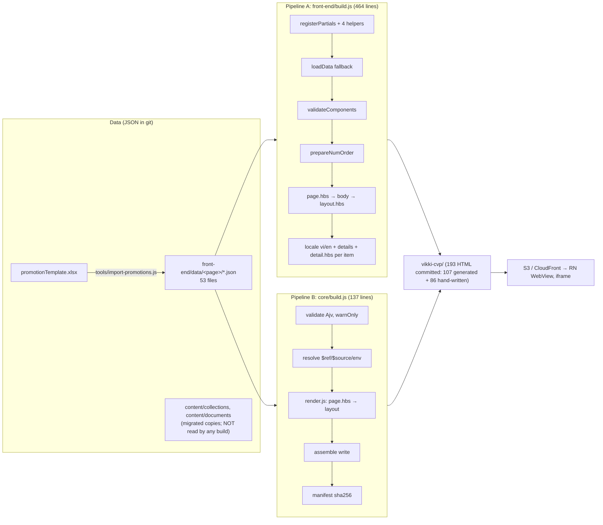

# 01: Audit of the current static content generation architecture

> **Audit date:** 2026-11-02 · **Commit:** `1123926` (main) · **Environment:** Node v24.5.0, macOS (Apple M5)
>
> **Evidence labels used throughout this set of documents:**
> - **[CODE]**: read directly from the source, with a `file:line` reference.
> - **[RUN]**: checked by actually running it, in a copy of the repo in a scratch directory (the repo itself was not touched).
> - **[DOC]**: from official documentation or a registry, with a link in [03](03-template-engine-research.md).
> - **[INFERENCE]**: a reasoned conclusion that has not been tested directly.
>
> No production code was changed. All builds and tests ran in a copy, or in `research/static-content-engine/experiments/`.

---

## 0. Summary of key findings

| # | Finding | Evidence | Severity |
|---|---|---|---|
| F1 | **Two build pipelines exist side by side and do not produce the same output.** `front-end/build.js` (legacy) reproduces 107/107 committed files byte for byte. `core/build.js` (the "target architecture") builds only 47 pages: 18 differ, and 60 pages are missing (all promotion/card-intro detail pages and every vi/en variant). | [RUN] | **Critical** |
| F2 | **Content is silently lost in production.** The clause "Chấm dứt sử dụng Thẻ" ("Termination of card use", a whole list of legal sub-clauses) exists in `front-end/data/vikki-go-plus-cvp/tc.json` (`sections[0].articles[14].blocks[1]`, a block with no `type`) but does not appear in `vikki-cvp/vikki-go-plus-cvp/tc.html`. The validator reports 53/53 files valid. | [RUN] | **Critical** |
| F3 | `core/build.js` drops the FAQ numbering (`1.` becomes `.`) because `prepareNumOrder()` was never ported. | [RUN] | High |
| F4 | `core/sanitize.js`, `core/theme.js` and `shell/shell.hbs` are **dead code**: no build path imports or registers them. | [CODE] grep | High |
| F5 | `core/sanitize.js` is a regex sanitiser that can be **bypassed**. Entity-encoded `javascript:` URLs pass through untouched, and the attribute-rebuild step turns `<a title='"onmouseover=…'>` into a real event handler. It also strips valid `class`/`type` attributes from 14 real content strings. | [RUN] | High (if wired in) |
| F6 | The Excel → JSON promotion import concatenates raw text into HTML (`tools/import-promotions.js:34-60`). Templates then output it with `{{{shortDesc}}}` and `{{{item.longDesc}}}`, with no escaping or sanitising anywhere along the way. | [CODE] | High |
| F7 | The production build is pinned to **handlebars 4.7.8** (`front-end/package-lock.json`), which is affected by the 2026 advisories fixed in 4.7.9 and 4.7.10 (including critical ones). The `xlsx@0.18.5` dependency has a high-severity advisory with no fix available on npm. | [RUN] `npm audit`, [DOC] | High |
| F8 | The `--watch` dev server has a **path traversal** bug: `GET /..%2f..%2f…/etc/hosts` returns the file, and it listens on `*:3000` (all network interfaces). | [RUN] | Medium (dev only) |
| F9 | Build performance is **not** a bottleneck: 107 pages / 5.4 MB in ~160–230 ms in-process. | [RUN] | n/a |

The issues that matter most (F1–F6) sit in **code organisation, the data contract and the trust model**. They are not limits of the Handlebars engine itself. See [06](06-gap-analysis.md).

---

## 1. Overview: two pipelines, one output folder



**Who calls which pipeline** [CODE]:

| Entry point | Pipeline | Note |
|---|---|---|
| `npm run build` / `npm run check` (root `package.json` → `front-end`) | **A (legacy)** | CI (`.github/workflows/ci.yaml`) runs `check` = build + `git diff --exit-code`, the byte-parity gate |
| `npm run cvp build` (`bin/cvp.js:10`) | **B (core)** | |
| `core/publish.js:39`, `tools/publish-to-static.js:30` | **B (core)** | The `publish-to-static.yaml` workflow runs `npm run build` (A) and then `publish-to-static.js` (B), so both write into the same `vikki-cvp/` folder within one job. With `--dry-run`, B has still written the files ([CODE] `buildAll` runs before the `dryRun` check, `tools/publish-to-static.js:30-45`) |
| `tools/catalogue.js`, `tools/spike-template-engine.js` | B's `createRenderer` | |

**[RUN] Build results compared against the committed `vikki-cvp/`:**

| Pipeline | Pages built | Byte-identical with what is committed | Missing |
|---|---|---|---|
| A `front-end/build.js` | 107 | **107/107** | 0 |
| B `core/build.js` | 47 | 29 | **60** (48 promotion/card-intro detail pages + 12 vi/en pages) |

The 18 differing files in B fall into two groups. Some lose FAQ numbering, e.g. `home-loan-cvp/index.html:1204` changes from `1. Tôi muốn mua nhà…` to `. Tôi muốn mua nhà…`. Others write files to paths that do not exist in production (`vikki-foreign-exchange-cvp/index.html`, `vikki-safe-plus-cvp/tc.html`…) because B has no locale branch.

---

## 2. Architecture discovery (per item in the request)

### 2.1 Template engine
- `handlebars` 4.7.x. Legacy resolves **4.7.8** (lockfile); root and core resolve **4.7.10** [RUN]. Templates are compiled at runtime with `Handlebars.compile`, with no precompile step.
- Legacy uses the global `Handlebars` instance (`front-end/build.js:3`). Core uses `Handlebars.create()`, an isolated instance (`core/render.js:14`).

### 2.2 Template folder structure [CODE]
```
front-end/
├── layouts/      8 layouts: base(15) template(130) static(242) legal-document(200) fee(404)
│                 promotion(181) blank(82) safe-plus-detail(22) — line counts; most of each is inline <style>
├── components/   22 partials + 15 *.block.json (contracts)
│   ├── header, footer, popup, qaTemplate, styles(714 lines CSS), scripts(310 lines JS)
│   ├── video, topMenu, image, slider, qa, activation, partners, title, tooltip, backLink, safePlus*
│   ├── legal/  section + blocks/{paragraph,subheading,list}      ← used by legal-document
│   └── static/ section, article, toc, legal-format-utilities + blocks/{paragraph,subheading,list,table}
└── pages/        18 page folders, 50 .hbs files:
                  17 empty (0 lines), 14 containing only <style>, 19 with markup
```
- A **page template** is the `body` of the layout. A page can therefore be: *empty* (the layout renders everything from data), *CSS only* (a page-specific skin), or *hand-written HTML* (e.g. `vikki-go-cvp.hbs`, 170 lines of hard-coded `topMenu`/`video`/sections, not data-driven).
- `vikki-cvp/` contains 193 committed HTML files. Only 107 are generated. **86 are hand-written** (9 folders with no source in `front-end/pages`: `booking-vja`, `td-cvp`, `loan-cvp`, …).

### 2.3 Input data [CODE]
- 53 JSON files in `front-end/data/<page>/`. Four shapes:
  1. **Landing** (`index.json` / `<page>.json`): `title, layout, className, hasTopSpace, components[], qaGroup[]`.
  2. **Document** (`tc*.json`, `fee.json`): `header` plus nesting at up to 4 levels: `blocks[]` / `sections[].blocks[]` / `sections[].articles[].blocks[]` / `sections[].sections[]…`. List items recurse through `children` (59 `children` nodes in `vikki-go-plus-cvp/tc.json`).
  3. **Collection** (`promotion/list.json`, 43 items; `card-intro/list.json`): `items[]` → one detail page per item.
  4. **Locale** (`vi.json`/`en.json`, `tc-vi.json`/`tc-en.json`, `claim-en.json`…), opt-in by file name.
- **Rich HTML in data:** 1,437 of 15,943 strings contain HTML tags [RUN]: `strong` 1,143, `li` 1,108, `p` 428, `span` 191, `a` 37; attributes `class` 143, `href` 37, `style` 2.
- `content/collections/*` and `content/documents/*` (migrated copies, ~39k lines) are **read by no build**. Only `tools/verify-roadmap.js` checks that they *exist* [CODE].

### 2.4 Data binding [CODE]
- `loadData()` tries candidate files in order. **The two pipelines use different orders:**
  - A: `<template>.json → list.json → <page>.json → index.json` (`front-end/build.js:76-92`)
  - B: `<template>.json → index.json → <page>.json → list.json` (`core/build.js:69-74`)
- Two-pass render: `body = pageTpl(data)`, then `layoutTpl({...data, body, page, template})`. The page and the layout share **the entire data object**.
- B adds `resolveData()`, which recursively walks the data to resolve `$ref` (`document:`/`page:`/`links.`), `$source` (collection query) and `{{env.cdnHost}}` (`core/resolve.js`). `resolveRef("document:…")` derives the URL from the last part of the ID with `-` as separator, so an ID like `vikki-safe-plus-cvp-claim-en` would map to `…/tc.html` [CODE, `core/resolve.js:24-31`]. `resolveCollectionQuery` re-reads `list.json` from disk on every query.

### 2.5 Conditionals and loops [CODE]
- `{{#if}}` ×113, `{{#each}}` ×36, `{{else}}` ×22, `(eq …)` ×27 [RUN grep]. Handlebars has no comparison operators, so `eq` is a custom helper.
- **Component dispatch uses an `if-eq` chain** (`layouts/template.hbs:12-72`; `static/section.hbs:27-45`; `static/article.hbs:14-30`; `legal/section.hbs:4-16`). An unknown `type` renders **nothing**:
  - For landing pages, legacy added `validateComponents()` with a hard-coded `KNOWN_BLOCK_TYPES` list (`front-end/build.js:101-135`), but it only checks `components[]` at the top level.
  - **Document blocks are not checked at all.** This is the direct cause of F2.

### 2.6 Partials, layouts, components [CODE]
- Partials are registered recursively, with the folder name as namespace (`static/blocks/list`). Recursion works (`static/blocks/list.hbs:14` calls itself).
- **Two parallel sets of partials** for the same document model: `legal/*` (3 blocks) and `static/*` (4 blocks). The markup differs only slightly (`<p class="legal-paragraph">` vs `<div class="…">`).
- **A layout has only one slot (`{{{body}}}`).** For a page to inject CSS into `<head>`, `legal-document.hbs:169` places `{{{body}}}` **inside `<head>`**, so the "body" of these pages is effectively a `<style>` block. Handlebars itself does support multiple slots via inline partials / partial blocks. The experiment shows this in `engines/handlebars/templates/layouts/shell.hbs`, so this is a code-organisation limitation, not an engine one.
- Partials have no props contract. The 15 `*.block.json` files describe props as JSON Schema, but `additionalProperties` is left open and the validator only **warns** on unknown block types (`core/validate.js:140-147`).

### 2.7 Helpers [CODE]
- Legacy has 4: `eq`, `json`, `inc`, `assetPath` (`front-end/build.js:7-59`).
- Core has 7: those 4 plus `t`, `action` and `block` (`core/helpers/*`). However, **no template in `front-end/` uses `t`/`action`/`block`**; only the dead `shell/shell.hbs` does. `block.js:8-10` contains `cond ? type : type`, a no-op, and recompiles the partial on every call if it is a string.
- The helper count is small, so there is no "helper sprawl". The real problem is logic placed in the wrong layer: `prepareNumOrder()` mutates data inside the build loop, and each page duplicates its own CSS.

### 2.8 CSS, JS, assets [CODE]
- `styles.hbs` (12.6 KB) and `scripts.hbs` (8.9 KB) are **inlined** into every page that uses `base`/`template` (via `header`/`footer`). The `static` (189 lines), `fee` (282), `legal-document` (156) and `promotion` (160) layouts each carry their own large `<style>` block.
- **Copy-pasted page CSS** [RUN diff -w]:

  | Pair | Lines differing / total |
  |---|---|
  | `vikki-od-at-branch-cvp/index` ↔ `vikki-nnn-cvp/index` | **0 / 221** |
  | `vikki-od-at-branch-cvp/index` ↔ `vikki-od-cbnv-cvp/index` | 4 / 221 |
  | `home-loan-cvp/index` ↔ `consumer-secured-loan-cvp/index` | 24 / 206 (only the class prefix) |
  | `vikki-loan-cvp/index` ↔ `vikki-od-cbnv-cvp/index` | 27 / 225 |
  | `vikki-go-plus-cvp` ↔ `card-co-badged-cvp` | 35 / 342 |
  | `vikki-golden-savings/index` ↔ `vikki-savings-kilo-gold/index` | 67 / 590 |

- Assets: inconsistent. Some places use `{{assetPath}}` (`popup.hbs`, `template.hbs`); others hard-code `./assets/` (`footer.hbs:2,9`, `video.hbs:5-17`). Swiper 11.2.10 and hls.js 1.7.4 are loaded from a CDN.
- `themes/*.json` and `themes/base.css` (design tokens) **are not applied** by any build path (`getThemeCss` is never called).

### 2.9 Localisation [CODE]
- Locales are opt-in by file name (`vi.json`/`en.json`, `<tpl>-<locale>.json`). The whole content is duplicated per language (e.g. `vikki-safe-plus-cvp`: 8 files).
- There is **no shared UI dictionary**. UI strings are hard-coded inside templates: `{{#if (eq language "en")}} FAQs {{else}} Hỏi đáp {{/if}}` (`template.hbs:85`), and `data-title="Hỏi đáp"` is fixed in Vietnamese even on English pages (`template.hbs:58`). The `t` helper and its dictionary in `core/helpers/t.js` are unused.
- Core has no locale branch at all (F1).

### 2.10 Dynamic content [CODE]
- Build time: `$ref`/`$source`/env (core only).
- Runtime: `scripts.hbs` reads the query string (`hasTopSpace`, `hasCard`, `productScheme`, `category`), opens iframe popups using `data-popup` as the URL (`scripts.hbs:56-120`, `iframe.src = type`), and talks to `ReactNativeWebView.postMessage`. The `runtime/*.js` files describe the contract but are not inlined into any page.

### 2.11 Validation [CODE] [RUN]
- `core/validate.js` uses Ajv 2020 with permissive schemas (`additionalProperties: true`), and unknown blocks only produce a **warning**. Result: 53/53 valid, 101 blocks, 0 warnings, even with F2 present.
- It lints hard-coded environment URLs and duplicate IDs. It does **not** check rich-text HTML, and does not use `security.allowedLinkHosts` from `cvp.config.json`.
- The Excel import has Ajv validation for structure, but none for HTML content (`tools/import-promotions.js:115-140`).

### 2.12 Render error handling [CODE]
- Legacy throws on unknown landing components, missing locale templates, and invalid or duplicate detail IDs (`front-end/build.js:119-135, 190-245`). Everything else (missing fields, unknown document blocks, missing partials inside an `if` branch) passes silently.
- Core: validation runs in `warnOnly` mode. The `block` helper throws on unknown types but is never called.

### 2.13 Build, preview, deploy [CODE] [RUN]
- Build A: ~1.05 s wall time cold, ~0.16–0.23 s in-process (render ≈ 157 ms, write ≈ 34–44 ms, read ≈ 13–64 ms; 165 compiles, 107 files, 5.37 MB). Peak RSS ≈ 90 MB.
- Build B: 1.36 s wall, RSS 120 MB (includes Ajv validation and the manifest).
- Preview: `node build.js --watch`, which runs a full rebuild on every change (no incremental build) and serves through `http.createServer` with path traversal (F8).
- Deploy: CI checks parity, and `publish-to-static.yaml` performs a dry-run publish. The legacy `sync-*.yaml` workflows referenced in older docs are no longer in the repo.

---

## 3. Analysis of the current implementation (questions from §2.2 of the request)

| Question | Answer | Evidence |
|---|---|---|
| Is logic duplicated? | **Yes, heavily**, at three levels: (1) two whole pipelines; (2) two partial sets `legal/*` and `static/*`; (3) page CSS copy-pasted between landing pages (0–35 differing lines out of ~220). Data is also duplicated: `content/` vs `front-end/data/` | §2.6, §2.8, F1 |
| Handlebars limits in *this* implementation? | No comparison operators (needs `eq`). Built-in `if` cannot be used as an inline subexpression. Escaping is HTML-only and not context-aware. No props contract. Templates are not type-checked. Most other pain points come from **how it is used** (one slot, `if` chains) and not from the engine | §2.5–2.6, [05](05-practical-evaluation.md) |
| Too many custom helpers? | **No.** 4 in use, 3 more unused | §2.7 |
| Business logic in templates? | A little: hard-coded locale choices, `data-title` text, hard-coded `./assets/` paths. The biggest piece of logic (`prepareNumOrder`) lives in the build script, mutating the data, and was lost when ported to core | §2.9, F3 |
| Hard to build complex templates? | Yes for **document** templates (4 nesting levels, two partial sets). Hand-written landing pages (`vikki-go-cvp`, `vikki-pro-cvp`) are not data-driven at all | §2.2–2.3 |
| Nested components? | Supported (recursive partials), with no contract between levels | §2.6 |
| Reuse across pages? | Good for document blocks. Poor for page skins (CSS copy-paste) | §2.8 |
| Hard to maintain and debug? | Yes: errors are silent (F2), two pipelines diverge (F1), there are no source maps, and the data fallback order differs by pipeline | §2.4, §2.12 |
| Performance with many pages? | **Not an issue** at the current scale. The experiment renders 1,000 large pages (90 MB) in ~0.3 s with Handlebars | F9, [05](05-practical-evaluation.md) |
| XSS / security? | **Yes, real exposure.** (1) Raw `{{{…}}}` output is used in 16 places (not counting `{{{body}}}`/`{{{json}}}`), for content that comes from Excel without sanitising (F6). (2) The sanitiser that exists is dead code and can be bypassed (F4–F5). (3) `data-popup` is used directly as `iframe.src`, so a `javascript:` URL would execute in the page origin [INFERENCE: based on browser behaviour for `iframe src=javascript:`]. (4) `onclick="toggle('body-{{id}}')"` (`static/section.hbs:4`) puts data into a JS context with only HTML escaping. (5) Vulnerable dependencies (F7). (6) The dev server (F8) | §2.11, F4–F8 |

---

## 4. Summary scorecard

| Criterion | Current state | Rating |
|---|---|---|
| Determinism (legacy) | 107/107 byte-identical, guarded by CI | Excellent |
| Pipeline consistency | Two pipelines; core is missing 60 pages | **Limited** |
| Content integrity | One T&C clause silently lost; validator does not detect it | **Limited** |
| Build speed | ~0.2 s in-process | Excellent |
| Dependencies | Small, but two have advisories (handlebars 4.7.8, xlsx) | Average |
| Component encapsulation | No props contract; dispatch via `if` chain | Limited |
| Layout composition | 8 layouts, one slot, heavy CSS duplication | Limited |
| XSS control | Raw output for untrusted content; sanitiser not used and bypassable | **Limited** |
| Localisation | Whole content duplicated per locale; UI strings hard-coded | Limited |
| Developer experience | No type checking, silent errors, dev server has a security hole | Average |
