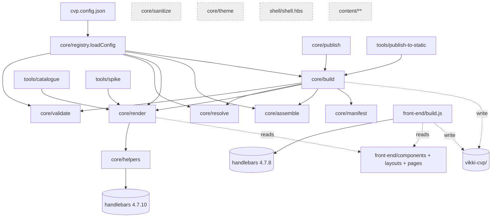

# 02: Repository Inventory

> Date: 2026-11-02 · Commit `1123926`. Line counts come from `wc -l`, and "used by" comes from grep across the whole repo, excluding `node_modules`. Evidence labels are as in [01](01-current-architecture.md).

## 1. Build and render modules

| Module / File | Responsibility | Input | Output | Dependencies | Issues |
|---|---|---|---|---|---|
| `front-end/build.js` (464) | **Legacy pipeline, the actual production one.** Registers partials and 4 helpers, loads data, branches by locale and detail pages, runs `validateComponents`, `prepareNumOrder`, and the dev server | `front-end/{pages,components,layouts,data}` | 107 HTML files in `vikki-cvp/` | handlebars **4.7.8** (lockfile), fs, http | Uses the global Handlebars instance. Recompiles the layout for every page. Code is duplicated between `renderPage()` and `buildPage()` (l.137-165 vs 318-354). `loadData(pageName)` is called without `templateName` (l.305), giving `undefined.json`. `prepareNumOrder` mutates data. Dev server has path traversal and binds all interfaces (F8) |
| `core/build.js` (137) | "Target" pipeline: validate → resolve → render → assemble → manifest | Same as above plus `cvp.config.json` | 47 HTML files plus `.manifest.json` | validate, resolve, render, assemble, manifest | **Missing** locale, detail pages, and `prepareNumOrder` (F1, F3). Data fallback order differs from legacy. Validation runs in `warnOnly` |
| `core/render.js` (87) | Creates a Handlebars instance, registers helpers and partials, renders page → layout | Template path, data | HTML string | handlebars 4.7.10, helpers, registry | Compiles the page and layout on every call (no cache). Does not register `shell/` |
| `core/resolve.js` (141) | `$ref`, `$source`, `{{env.*}}` | Raw data | Resolved data | fs, registry | `document:` ref is resolved by splitting on `-` (fragile). Collections re-read the file on every query. The `front-end/data` path is hard-coded |
| `core/assemble.js` (57) | Writes HTML, copies assets | HTML | File | fs | `copyPageAssets` is never called |
| `core/validate.js` (287) | Ajv validation of data against content-types and `*.block.json`, plus env-URL and duplicate-ID lint | `front-end/data` | Report | ajv 8, ajv-formats | Permissive schemas. Unknown blocks only produce a warning. Untyped document blocks are not checked (F2). Rich HTML and `allowedLinkHosts` are not checked |
| `core/registry.js` (119) | Discovers content-types, blocks, templates. `loadConfig` | `cvp.config.json`, `*.block.json` | Registry object | fs | `loadConfig` reads the file on every call (it is called from almost every module) |
| `core/sanitize.js` (102) | Regex sanitiser | HTML string | HTML string | n/a | **Dead code.** Can be bypassed with entity encoding or attribute breakout. Strips `class` from `p/ul/li` (F5) |
| `core/theme.js` (30) | JSON tokens → `:root{}` CSS | `themes/*.json` | CSS string | fs | **Dead code** |
| `core/helpers/*` (7 files) | eq, json, inc, assetPath, t, action, block | n/a | n/a | handlebars | `t`, `action`, `block` are not used by any real template. `t` has its dictionary hard-coded in JS |
| `core/manifest.js` (229) | Manifest with sha256, verify, orphans | `vikki-cvp/` | `.manifest.json` | crypto | Covers all 193 files, including hand-written ones (useful) |
| `core/inventory.js` (181) | Inventory report, exports `registry.json` | Registry | `registry.json` (18.5 KB) | registry | n/a |
| `core/publish.js` (60) | Filters pages by `content/publish.json`, then calls `buildAll` | env | Builds **all** pages | build | The filter list is only logged; it does not limit the build |
| `shell/shell.hbs` (45) | A single shell (head/body/popup/FAQ), uses `{{block}}` and `{{t}}` | n/a | n/a | n/a | **Dead code** (not registered) |
| `themes/*.json`, `base.css` | Design tokens | n/a | n/a | n/a | Not applied |
| `runtime/*.js` (4 files, ~370) | Contracts for query parameters, RN bridge, iframe messaging | n/a | n/a | n/a | Not inlined into any page. The real runtime is `components/scripts.hbs` |
| `bin/cvp.js` (44) | CLI dispatcher | argv | spawn | child_process | `build` points to core (not legacy) |

## 2. Templates

| Group | Files | Responsibility | Issues |
|---|---|---|---|
| `layouts/template.hbs` (130) | 1 | Landing shell with `components[]` dispatch and the FAQ popup | `if-eq` chain ×8. UI strings hard-coded vi/en. `data-title="Hỏi đáp"` is fixed in Vietnamese |
| `layouts/static.hbs` (242) | 1 | T&C document (23 data files) | 189 lines of inline CSS |
| `layouts/legal-document.hbs` (200) | 1 | T&C (2 data files) | `{{{body}}}` is placed inside `<head>`. Parallel partial set `legal/*` |
| `layouts/fee.hbs` (404) | 1 | Fee schedule (7 files) | 282 lines of inline CSS |
| `layouts/promotion.hbs` (181), `blank`, `base`, `safe-plus-detail` | 4 | List/detail, shells | Duplicated CSS |
| `components/styles.hbs` (714), `scripts.hbs` (310) | 2 | Global CSS/JS, inlined into every page | 21.5 KB repeated per page. No minification, no cache sharing |
| `components/*.hbs` (landing blocks) | 13 | video, topMenu, image, slider, qa, activation, partners, title, tooltip, backLink, safePlus* | `video.hbs` hard-codes `./assets/`. `slider.hbs` builds an inline `style` from data. `backLink.hbs` embeds its own `<style>` |
| `components/static/**` | 8 | Document section, article, toc, blocks | `onclick="toggle('body-{{id}}')"` puts data into a JS context. `static/toc` is commented out in the layout |
| `components/legal/**` | 4 | Duplicate of the document blocks | Duplicates `static/**` |
| `pages/*/*.hbs` | 50 (18 folders) | Page body | 17 empty, 14 contain only `<style>`, 19 with markup. CSS copy-paste between landing pages (see [01 §2.8](01-current-architecture.md)) |
| `*.block.json` | 15 | Props contracts (JSON Schema) | Permissive. Not tied to the rendering code |

## 3. Data and content

| Folder | Files | Read by | Issues |
|---|---|---|---|
| `front-end/data/<page>/*.json` | 53 (+ xlsx, 2 html tools) | Both pipelines | 1,437 strings contain HTML. One block has no `type` (F2). Whole content is duplicated per locale |
| `content/documents/**`, `content/collections/**` | 80 (~39k lines) | **No build reads them** (only `verify-roadmap` checks they exist) | A second source of truth: at risk of drifting from `front-end/data` |
| `content/publish.json` | 1 | `core/publish.js` (log only) | Does not affect the output |
| `content-types/*.schema.json` | 7 | validate | `additionalProperties: true` |
| `vikki-cvp/**` | 193 HTML, 743 MB including assets | Deploy | 86 hand-written files not managed by the generator |

## 4. Tools

| File | Responsibility | Issues |
|---|---|---|
| `tools/import-promotions.js` (228) | Excel → `promotion/list.json` | **Raw text is concatenated into HTML** with no escaping (F6). `xlsx@0.18.5` has advisories GHSA-4r6h-8v6p-xvw6 and GHSA-5pgg-2g8v-p4x9, with no fix on npm |
| `tools/migrate/{documents,collections}.js` | Migrate into `content/` | Output is not used |
| `tools/catalogue.js` (176) | Block catalogue HTML | Uses core `createRenderer` |
| `tools/spike-template-engine.js` (151) | "Benchmark" of Handlebars vs component rendering | **Not a valid benchmark.** The two sides produce different HTML, the "component" side has no escaping, and the line "Deterministic: 100%" is a hard-coded string (l.137). See [05 §1](05-practical-evaluation.md) |
| `tools/verify-roadmap.js` (115) | Checks roadmap phases | Checks files *exist*, not behaviour. Passes even though the core pipeline is missing 60 pages |
| `tools/publish-to-static.js` (94) | Copies output to the static repo | Runs the core build before the dry-run check |

## 5. Coupling between modules

**Assessment:**
- **Shared templates, divergent pipelines.** Both pipelines read the same `front-end/components|layouts|pages`, but their *runtime semantics* differ: helper sets, data order, locale handling, detail pages. Any template change has to be correct for both, and CI only protects legacy.
- **`loadConfig()` is the shared hub.** It is called from 7+ modules, re-reads the file on every call, and has no schema. It is not a performance bottleneck, but it is a single point where configuration errors would spread everywhere.
- **The "Target Architecture" is wired in incompletely.** Four of its components (sanitize, theme, shell, content/) are not connected. The roadmap check (`verify-roadmap.js`) only proves the files exist.

## 6. Potential bottlenecks

| Point | Kind | Current state | When it would become a bottleneck |
|---|---|---|---|
| Full rebuild in `--watch` | DX | ~1 s per change | Only with thousands of pages; not a priority |
| Inlined CSS/JS (~21.5 KB/page + per-layout CSS) | Payload / cache | Every page loads it again | WebView loads many pages per session (FAQ iframe, detail pages) |
| `resolveCollectionQuery` re-reading the file | Build | Negligible | When many pages query collections |
| Manual Excel → JSON → HTML | Process / security | One-way, no review of HTML | Every time marketing updates promotions |
| CI parity guarding only legacy | Release process | Core can drift without anyone noticing | Right now: the publish workflow already calls core |
| **Real bottleneck: the trust model and data contract** | Correctness | Silent errors, raw HTML | Already happening (F2) |
