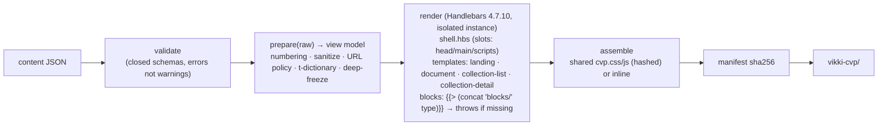
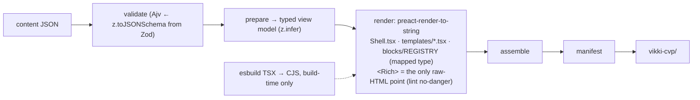
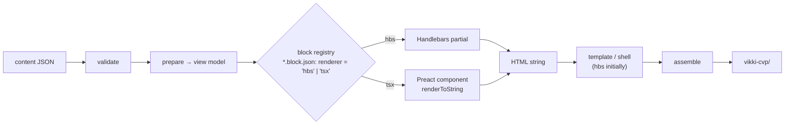

# 07: Architecture proposals

> Based on [06](06-gap-analysis.md). Costs are estimates **[INFERENCE]** for 1–2 FE engineers who know the repo. They are not measured.
>
> **Phase 0 applies to every option.** Whichever option is chosen, these fixes do not depend on the engine and must be done first:
>
> | Step | Fix | Gap |
> |---|---|---|
> | 0.1 | One pipeline that both publish and CI use | G1 |
> | 0.2 | Fail-fast dispatch plus closed schemas for document blocks; restore the lost clause | G2 |
> | 0.3 | Real sanitiser and URL policy in the data layer; escape text in the Excel import | G3, G4 |
> | 0.4 | Handlebars ≥ 4.7.10; deal with `xlsx` | G5 |
> | 0.5 | Fix the dev server | G14 |
>
> Estimate: **1.5–2.5 weeks.**

---

## Option A: Keep Handlebars and restructure (Hardened Handlebars)

### Architecture overview

What it looks like in practice (shown in `experiments/engines/handlebars/`):
- **One shell** with inline-partial slots, replacing 8 one-slot layouts.
- **Dispatch through dynamic partials**, which throw automatically for an unknown `type` (case-sensitive).
- **All logic moved into `prepare()`**, which is pure and unit-testable. Templates only present.
- Helpers kept to a small set: `eq`, `when`, `cx`, `asset`, `t`, `json`.
- `legal/*` merged into `static/*`. Page skins become `className` plus theme tokens instead of copied CSS.
- **Contract:** tighter `*.block.json` + Ajv. Optionally generate `.d.ts` types with `json-schema-to-typescript` for helpers and `prepare.js`.

| Aspect | Assessment |
|---|---|
| Pros | No change of engine or syntax: the team keeps working as today. Lowest risk. Byte parity can be kept step by step. Fixes all Critical/High gaps (G1–G9) |
| Cons | No typed props in templates (G11 remains). Slot syntax with inline partials is hard to read. Handlebars has security releases but is slow to evolve (v5 unpublished). Still needs a few helpers to make up for the missing syntax |
| Technical complexity | Low |
| Migration effort | Phase 0 + 3–5 weeks (shell/templates and merging partials need visual diffs) |
| Performance | Unchanged (~3k pages/s in the experiment; ~0.2 s for 107 pages) |
| Long-term maintenance | Good, provided the contract and tests are kept in place. Engine risk: Handlebars' release cadence. Mitigated by the low complexity of the templates (portable, see doc 10 §1) |
| Compatibility with the current repo | **Highest:** it is the evolution of the current code. Parity gates still apply |
| Risks | (1) Restructuring without visual diffs could change legal markup. (2) Team habits (raw `{{{ }}}`) creep back without a lint/grep check in CI. (3) A future requirement such as typed props or a shared admin preview would cost more if no seam is left for it now |

---

## Option B: Replace the template engine

### Choosing a replacement candidate (from [04](04-comparison-matrix.md) and [05](05-practical-evaluation.md))

| Candidate | Why it is or is not the replacement |
|---|---|
| Nunjucks | Nicest syntax (native `extends`, operators). **But** no release in ~3.5 years, and dynamic includes are case-insensitive on macOS. Swapping one ageing engine for another more stagnant one is not an improvement |
| LiquidJS | Very active, but **does not escape by default**, `""` is truthy, and it has the most friction plus ~18 advisories in 2026. Its sandboxing strength is not needed here, because admins edit data, not templates |
| Eta / EJS | Fast, but JS in templates pulls logic back in. Eta: `include` is raw output. EJS: no layouts, and 4 breaking majors in one year |
| Pug | Total rewrite into a non-HTML syntax. Maintenance-only |
| **Preact TSX (`preact-render-to-string`)** | **The only candidate that adds a capability Handlebars lacks:** typed props + a registry checked by `tsc`, and a single raw-HTML entry point. Active. Not shipped to the client |

→ The representative for Option B is **Preact TSX in the repo's own pipeline**, with all of Handlebars replaced.

### Architecture overview

| Aspect | Assessment |
|---|---|
| Pros | Typed props (G11), errors caught in the IDE. One schema source produces TS types and JSON Schema for admin forms. A single raw-HTML point. The same components can render an admin preview in the browser. The ecosystem is very active |
| Cons | Rewrite every template: ~50 page `.hbs`, 8 layouts, 22 partials. The experiment shows TSX is ~2× the code size. Needs a toolchain: esbuild, tsconfig, Zod/TS. Byte parity is lost (whitespace and attribute output differ), so parse5-normalised parity or visual diffs are needed. Requires JSX/TS skills (UNVERIFIED for this team) |
| Technical complexity | Average–high |
| Migration effort | Phase 0 + **6–10 weeks** for a full replacement, including normalised/visual parity for 107 pages and Legal sign-off on documents |
| Performance | Slightly faster than Handlebars in the experiment (5.4k vs 3.0k pages/s); cold +~40 ms for esbuild. Negligible |
| Long-term maintenance | Good: types protect refactors, and the libraries are healthy. Adds the burden of upgrading the TS/esbuild/Preact toolchain |
| Compatibility with the current repo | Low: it replaces the whole template layer. `scripts.hbs`/`styles.hbs` would become static files |
| Risks | (1) **Big-bang risk** on legal content (T&C/fees, ~84% of data). (2) Team not fluent in JSX. (3) Development time taken from Phase 0 if not sequenced carefully. (4) Developers drifting into client-side interactivity (must be blocked in review: no shipping Preact to the WebView) |

---

## Option C: Hybrid static content engine

### C1 (main variant): own pipeline + a renderer interface at block level

- **Interface:** `renderBlock(type, props, ctx) → string`. This is the **only** abstraction, and it sits at block level. Not a generic "engine adapter" layer.
- **Default stays Handlebars.** A block only switches to TSX when it is new or being redesigned (doc 10 §7.4), never for a pure engine swap.
- Mixing is engine-internal only. A JSX block is inserted into a Handlebars template as a `SafeString` through the `{{block}}` helper that already exists in `core/helpers/block.js` (it needs fixing).
- **Exit criterion:** if after N months nothing has moved to TSX, delete the seam. That is cheap, because it is one function.

| Aspect | Assessment |
|---|---|
| Pros | Migrate **one block at a time**, reversibly (one line in `block.json`). Leaves room for typed props and admin preview **only when actually needed**. Keeps byte parity for untouched pages |
| Cons | Two renderers in parallel: two mental models, two sets of helpers to keep in sync (`asset`, `t`, `cx`), and debugging goes through two layers. If the "temporary" phase drags on, maintenance costs double |
| Technical complexity | Average (one interface + esbuild for TSX blocks) |
| Migration effort | Phase 0 + Option A's restructuring (2–3 weeks) + seam and first TSX block (1–2 weeks). After that, per block, as needed |
| Performance | Equal to A for hbs blocks; slightly faster for TSX blocks. Negligible |
| Long-term maintenance | Good **if** there is a deadline or exit criterion. Bad if two renderers live side by side indefinitely |
| Compatibility with the current repo | High: it builds on top of A |
| Risks | Partial migration that never finishes; helpers drifting between the two renderers (mitigated by shared helpers in `lib/helpers.js`, as in the experiment) |

### C2 (variant): adopt an SSG framework (Astro or Eleventy) as the pipeline

| | Astro 7 | Eleventy 3 / Build Awesome |
|---|---|---|
| Fit | Excellent component model (props, slots, scoped CSS, content collections + Zod) | Can **keep Nunjucks/Liquid templates unchanged** ([RUN]); Handlebars via a plugin |
| Cost | Replaces `core/*`, the manifest, the parity gate and the output layout (`build.format`, `_astro/` hash). Rewrites templates into `.astro` | Data mapping (`eleventyComputed`) and filter seams ([RUN]); +~0.5 s fixed build overhead |
| Risks | Container API (rendering outside the build) is still experimental; incremental builds are experimental; framework lock-in | Rename/organisational changes (Font Awesome → Build Awesome, Pro tier); Handlebars is no longer in core; low WebC adoption |
| When it makes sense | When the team would rather **not own** the pipeline (registry/resolve/assemble/publish) | When moving to Nunjucks and wanting an off-the-shelf data cascade/pagination |

**Assessment:** at about 110 pages, with a small pipeline that already exists and a fixed output format (`vikki-cvp/<page>/<file>.html` for the WebView), C2 **replaces what is already working** (the pipeline) without fixing the real problems (contract, sanitisation, duplication). **Not recommended now.**

---

## Summary comparison

| Criterion | A: Hardened Handlebars | B: Preact TSX (replace all) | C1: Hybrid hbs + tsx | C2: Astro / 11ty |
|---|---|---|---|---|
| Fixes Critical/High gaps (G1–G9) | ✓ (Phase 0 + restructure) | ✓ | ✓ | ✓ (still needs Phase 0) |
| Fixes G11 (typed props) | ✗ | ✓ | ✓ for migrated blocks | ✓ (Astro) / ✗ (11ty+njk) |
| Effort after Phase 0 | 3–5 weeks | 6–10 weeks | 3–5 weeks (A) + 1–2 weeks (seam) + per block | 6–12 weeks [INFERENCE] |
| Risk to legal content | Low | High | Low | High |
| Byte parity during migration | Keepable per step | Lost | Kept for hbs blocks | Lost |
| New dependencies | 0 (just upgrade hbs) | preact, prts, esbuild, (zod, typescript) | Same as B, but only build-time | astro/vite or @11ty/eleventy |
| Team skills | Already present | JSX/TS (UNVERIFIED) | Gradual | Framework-specific |
| Long-term maintenance | Good | Good | Good if there is an exit criterion | Depends on the framework |
